# Quality Gates on a Running Pipeline

**A hands-on data engineering project for beginners.** Learn the one skill most pipelines are missing: deciding which quality checks a table needs, and why.

> Can I pay the bonus from last week's net sales, store by store? And if I cannot trust a number, which one, and why?

The head of retail operations asks that every Monday. The pipeline has five checks, and they are all green. One store's number is still wrong. You find out why, and you build what would have caught it.

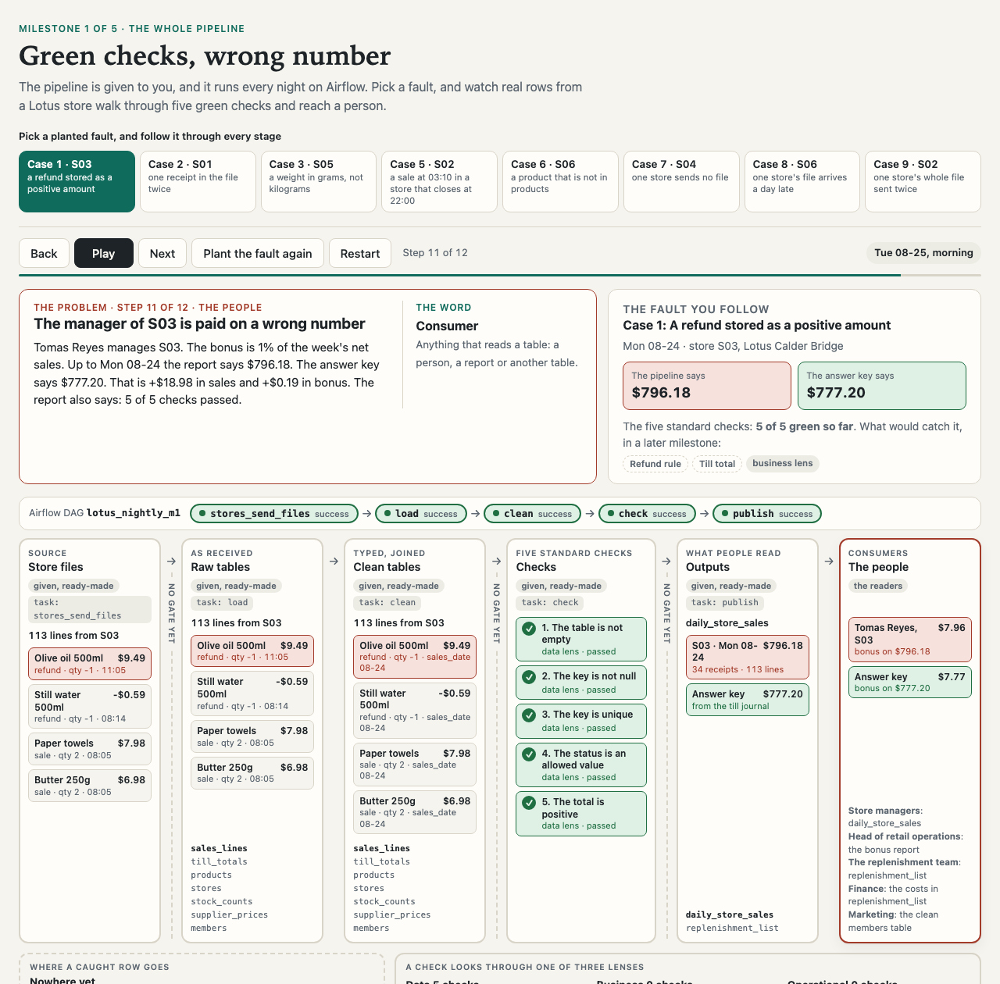

*The flow page of milestone 1. Pick a planted fault and watch real rows walk through five green checks.*

| | |
|---|---|
| **Who it is for** | You know some Python and a little SQL. You have never built a pipeline, and never used dbt, Docker or Airflow. You do not need another D8Loop project first |
| **What you need** | Git, Python 3.12 or later, and [uv](https://docs.astral.sh/uv/). Docker from milestone 1 on, installed click by click in [its README](src/m1_green_checks_wrong_number/#set-up) |
| **What it costs** | Nothing. No API key, no cloud account, no AI. Everything runs on your computer |
| **Status** | Milestones 1 to 4 of 5 are complete. Milestone 5 is being built |

It is the third project of the [D8Loop Data Engineering Projects](https://www.d8loop.com/modules/knowledge-corner/data-engineering-projects#data-quality-and-reliability) series, in the **Data quality and reliability** category. The first two are [Retail Profit Stack](https://github.com/vijaysngrajput/retail-profit-stack) and [Daily Orders: API to Warehouse](https://github.com/vijaysngrajput/daily-orders-api-to-warehouse).

## Try it in two minutes

You need Git and uv. **No Docker.**

```sh
git clone https://github.com/vijaysngrajput/quality-gates-on-a-running-pipeline.git
cd quality-gates-on-a-running-pipeline
uv sync                   # makes the virtual environment and installs everything
uv run python try_it.py   # six stores send their files, and the pipeline runs for one night
```

You get the report the bonus is paid from:

```
check:   the five standard checks
  1. The table is not empty           clean.sales_lines    PASS
  2. The key is not null              clean.sales_lines    PASS
  3. The key is unique                clean.sales_lines    PASS
  4. The status is an allowed value   clean.sales_lines    PASS
  5. The total is positive            clean.sales_lines    PASS
  5 of 5 checks passed.

Lotus Retails. Store managers' bonus, week of Mon 2026-08-24
Net sales from Mon 2026-08-24 to Mon 2026-08-24

  Store                           Manager              Net sales  Bonus (1%)
  S01  Lotus Ashby High Street    Marta Lindqvist        $795.24       $7.95
  S02  Lotus Ashby Market Square  Dana Okafor            $901.28       $9.01
  S03  Lotus Calder Bridge        Tomas Reyes            $796.18       $7.96
  ...
  Checks: 5 of 5 passed.

Five checks, all green. Now add up store S03's receipts yourself:
  the receipts say $777.20. The report above says something else.
```

That contrast is the project: **the same data, the same day, green checks, and a wrong number.**

`uv run python try_it.py --finished` will run the finished pipeline on the same night, with one store marked "do not pay yet", the rows set aside, and the reason. It arrives with milestone 5.

## The idea

Most engineers write the same few checks on every table: the row count is not zero, the key is not null, the key is unique, the total is positive. They cannot say what each check protects. So the checks pass, and the data is still wrong.

This project teaches the step that comes **before** writing a check.

1. **Every table is different.** A table of sales, a table of products and a file from a supplier fail in different ways.
2. **A check has a reason.** You can say who uses the table, what they decide with it, and what goes wrong for them.
3. **Many checks need work first.** The data must be joined, added up, or compared with a normal day.
4. **A check looks through one of three lenses.** A **business** check tests a rule of how the company works. A **data** check tests the values themselves. An **operational** check tests the pipeline: did it run, on time, with a normal amount of data.

## The business

**Lotus Retails** is a fictional chain of supermarkets: six stores in three towns. Customers pay at the tills. A **till** is the machine at the counter where a customer pays. It is also called a cash register. Four groups use the data, and each is hurt in a different way when it is wrong.

| Who | What a wrong value does |
|---|---|
| Store managers | They are paid a weekly bonus on net sales. A wrong number is wrong pay |
| The replenishment team | They order tomorrow's stock from yesterday's sales. Too high wastes food. Too low leaves empty shelves |
| Finance | They pay suppliers from the price file. A wrong price is wrong money leaving the company |
| Marketing | They email loyalty members. One person stored twice gets two emails |

Open [the business page](https://vijaysngrajput.github.io/quality-gates-on-a-running-pipeline/understand_business/lotus_retails.html) to follow one receipt from the till to the bonus.

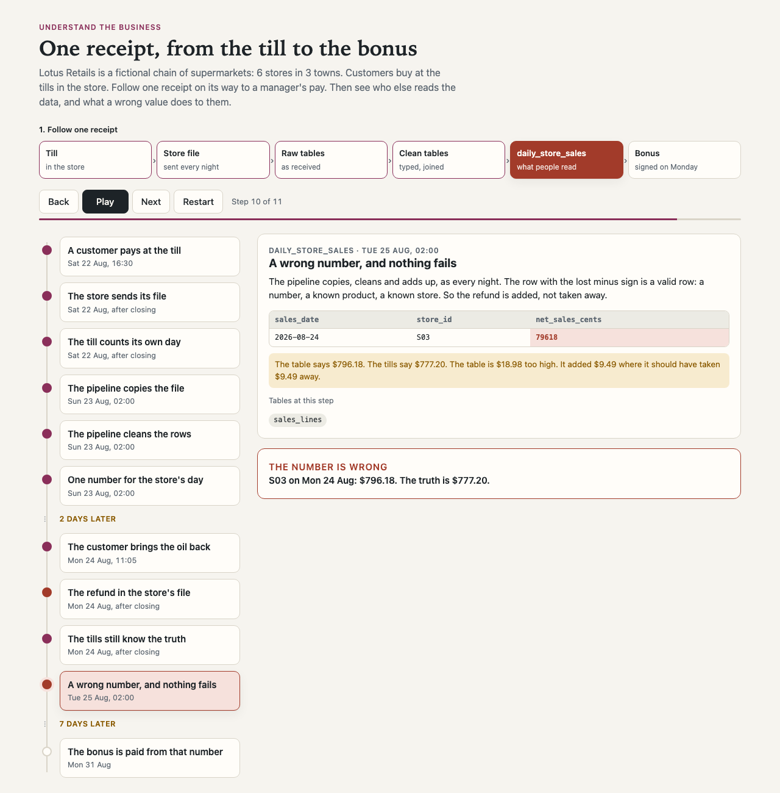

## What you are given, and what you build

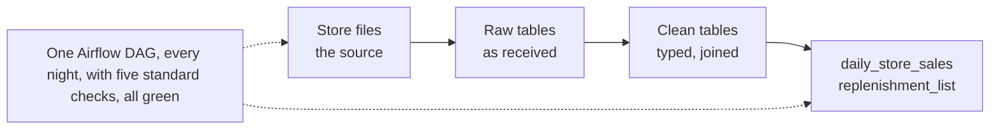

**Given, ready-made:** a small source system that writes each store's files and can be told to misbehave. A starter pipeline in plain Python and SQL. One Airflow DAG that runs it every night. Five standard checks. An answer key.

**Built by you, one milestone at a time:** a check card for each table. Checks through all three lenses. Gates that stop a bad night. Quarantine for bad rows. Run history, alerts, and a recovery with a backfill.

| Tool | Its job here |
|---|---|
| **dbt** | It holds the rule. "The receipts must equal the till total" is a test: a query that returns the rows that break the rule. From milestone 4 |
| **Airflow** | It runs the rule and acts on the result: when the check runs, what waits for it, what happens when it fails, who is told |

## Milestones

Five milestones. Each one ends with something that is **still wrong**. That is the reason the next one exists.

| Milestone | What you do | Still wrong at the end | Notebooks |
|---|---|---|---|
| [1. Green checks, wrong number](src/m1_green_checks_wrong_number/) | Install Docker, run the given pipeline, work one store's number out by hand, and find they differ. Ask who uses each table. Meet the check card. Read the table before checking it | We found one error by luck. We have no checks that would have caught it | 8 |
| [2. Checks with a reason](src/m2_checks_with_a_reason/) | Write the checks for `sales_lines` through each lens, by hand first. See what the common version of each check misses | One table is done well. There are five more, and they are nothing like it | 8 |
| [3. Every table is different](src/m3_every_table_is_different/) | A check card and checks for the other five tables. A written contract for the supplier's file. The seven cards side by side | The checks exist in notebooks. The pipeline does not run them, and a failure changes nothing | 8 |
| [4. Gates and quarantine](src/m4_gates_and_quarantine/) | Every check becomes a dbt test, and three gate tasks in Airflow act on them: block, quarantine or warn. The report says which store to pay, and why not | A gate fails at 02:00, and nobody knows until a store manager complains | 8 |
| 5. Know, alert, recover | Run history, alerts, and four recovery drills with a backfill | Nothing | Planned |

You practise the five things this category is made of: **quality checks, quarantine, alerts, backfills and run history**.

## The planted cases

Thirteen faults are planted on known dates, so each can be checked with a pencil. **Every one passes all five standard checks.** That is the point.

At the end of the bonus week the starter pipeline has run seven nights. All 35 checks are green, and all six stores have a wrong number.

| Case | What happens | Lens |
|---|---|---|
| A refund stored as a positive amount | Net sales are $18.98 too high for one store | Business |
| One receipt in the file twice, with different line ids | The key is still unique. $18.07 is counted twice | Data |
| A weight entered in grams, not kilograms | One line of bananas is $1,522.20, more than the store's whole day | Business |
| One store sends no file | Every check passes: there are no rows to fail | Operational |
| The supplier sends cost in cents | Every cost is 100 times too high, and still a valid number | Business |

All thirteen, with dates and amounts, are in [answer_key/planted_cases.json](answer_key/planted_cases.json) and in the [data proposal](docs/source_data_proposal.md#4-the-planted-cases).

## Start here

1. **Understand the business.** Open [the business page](https://vijaysngrajput.github.io/quality-gates-on-a-running-pipeline/understand_business/lotus_retails.html).
2. **Try it in two minutes** (above).
3. **Work through the milestones in order**, starting with [milestone 1](src/m1_green_checks_wrong_number/). Its README installs Docker and Airflow click by click.

The pages ending in `.html` are animated. GitHub shows only their source, so view them online here, or open them from your own copy of the project.

| Page | What it shows |
|---|---|
| [One receipt, from the till to the bonus](https://vijaysngrajput.github.io/quality-gates-on-a-running-pipeline/understand_business/lotus_retails.html) | Who uses which table, and what a wrong value does to each of them |
| Flow pages: [1](https://vijaysngrajput.github.io/quality-gates-on-a-running-pipeline/src/m1_green_checks_wrong_number/milestone_1_flow.html) · [2](https://vijaysngrajput.github.io/quality-gates-on-a-running-pipeline/src/m2_checks_with_a_reason/milestone_2_flow.html) · [3](https://vijaysngrajput.github.io/quality-gates-on-a-running-pipeline/src/m3_every_table_is_different/milestone_3_flow.html) · [4](https://vijaysngrajput.github.io/quality-gates-on-a-running-pipeline/src/m4_gates_and_quarantine/milestone_4_flow.html) | The whole pipeline at each milestone, with real rows moving through it. The same layout every time, so you see what changed |
| Recap pages: [1](https://vijaysngrajput.github.io/quality-gates-on-a-running-pipeline/src/m1_green_checks_wrong_number/milestone_1_recap.html) · [2](https://vijaysngrajput.github.io/quality-gates-on-a-running-pipeline/src/m2_checks_with_a_reason/milestone_2_recap.html) · [3](https://vijaysngrajput.github.io/quality-gates-on-a-running-pipeline/src/m3_every_table_is_different/milestone_3_recap.html) · [4](https://vijaysngrajput.github.io/quality-gates-on-a-running-pipeline/src/m4_gates_and_quarantine/milestone_4_recap.html) | What was asked, what you built, what you learned, what is still wrong |
| [The check cards](https://vijaysngrajput.github.io/quality-gates-on-a-running-pipeline/checks/check_cards.html) | Every table's check card side by side, growing as the project goes on |

No number on these pages is typed by hand. A script runs the real code and writes what happened into the page, and a test fails when a page is out of date.

| 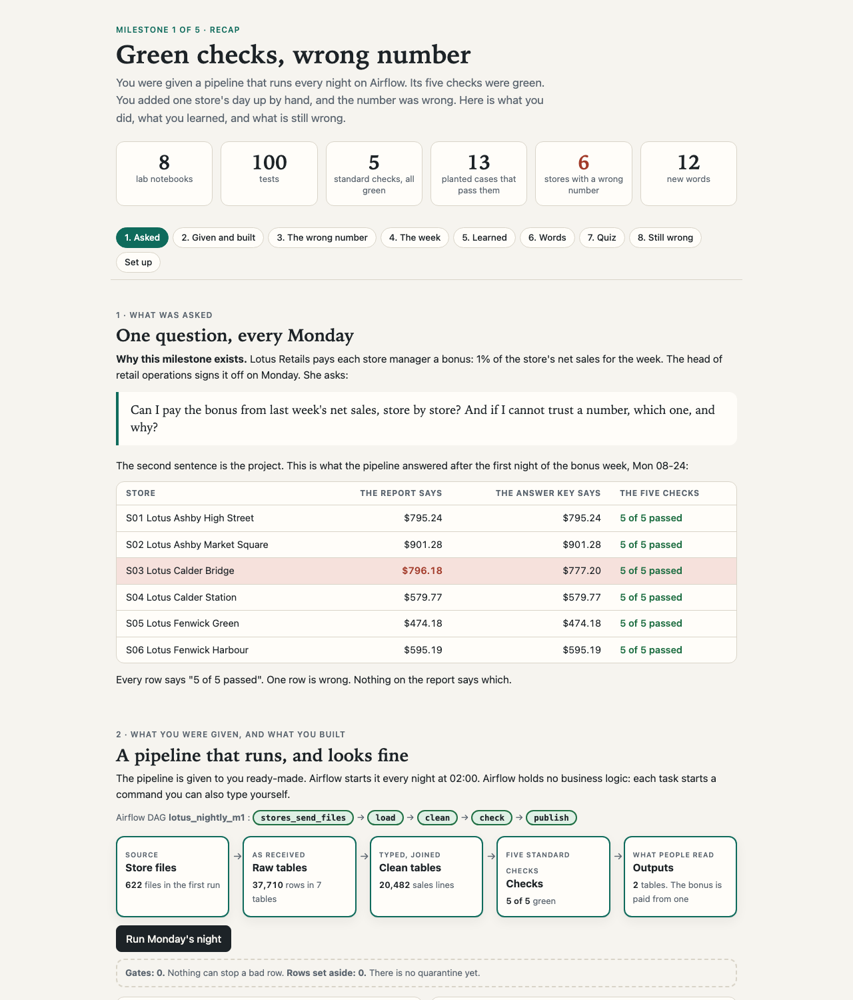 | 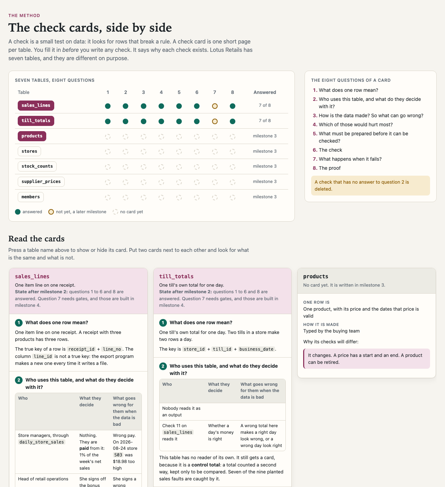 |
|---|---|
| *The recap page of milestone 1.* | *The check cards, side by side.* |
| 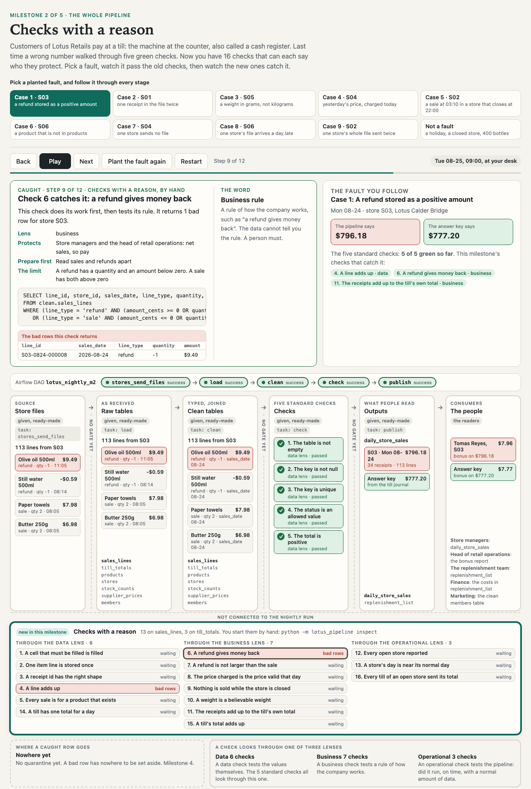 | 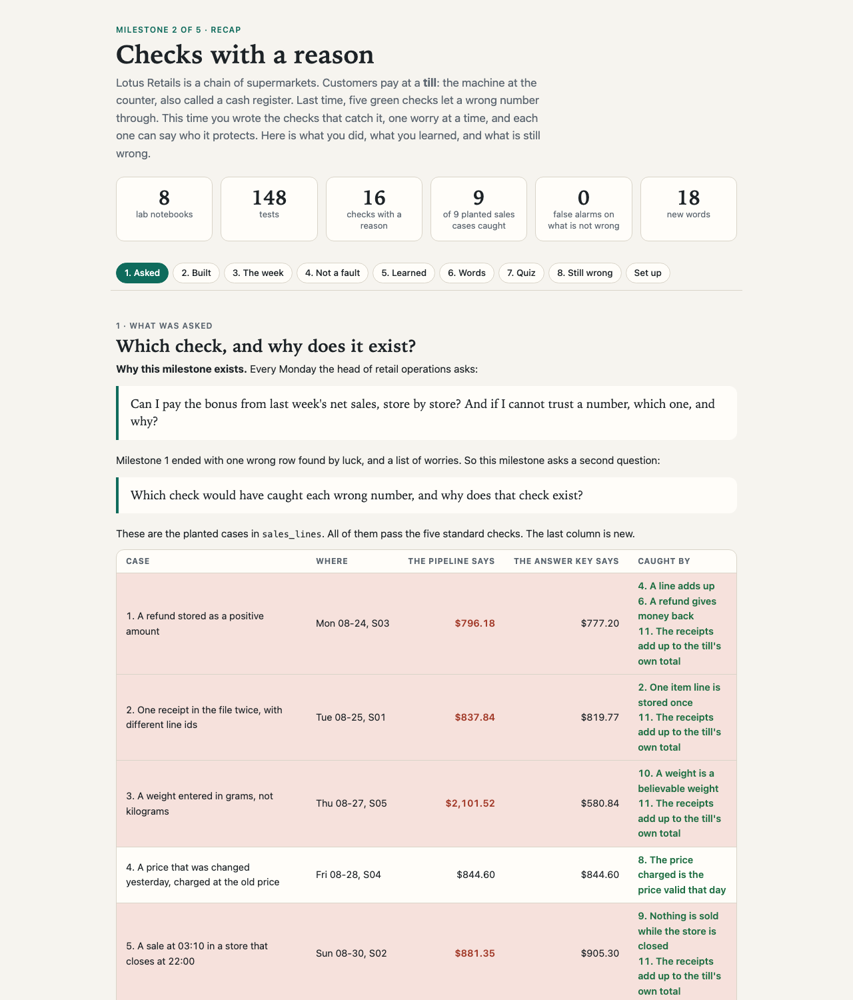 |
| *Milestone 2. The same refund, caught by a check that knows what a refund is.* | *The recap page of milestone 2.* |
| 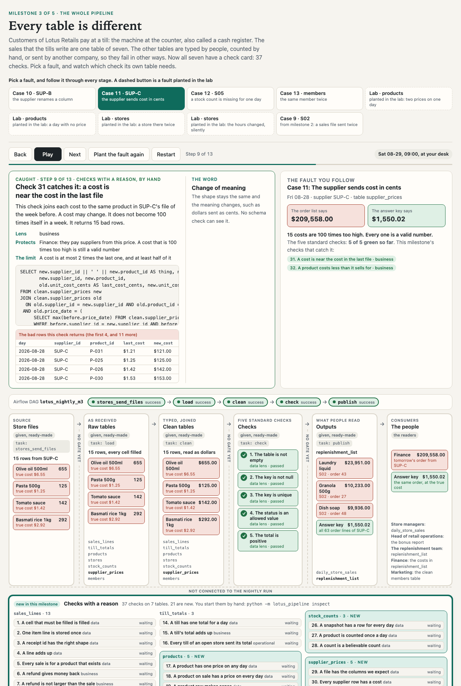 | 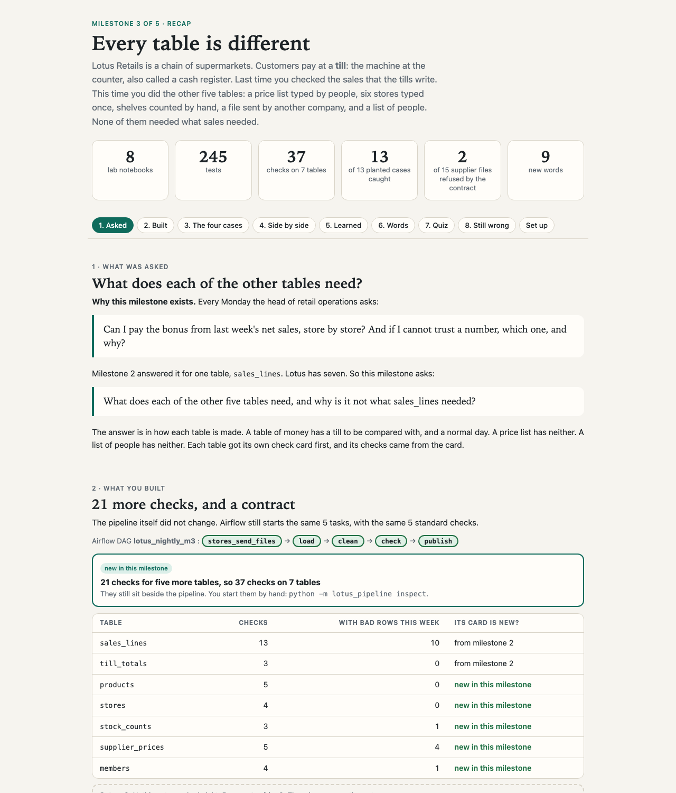 |
| *Milestone 3. A supplier's file with a perfect shape and a wrong meaning.* | *The recap page of milestone 3.* |
| 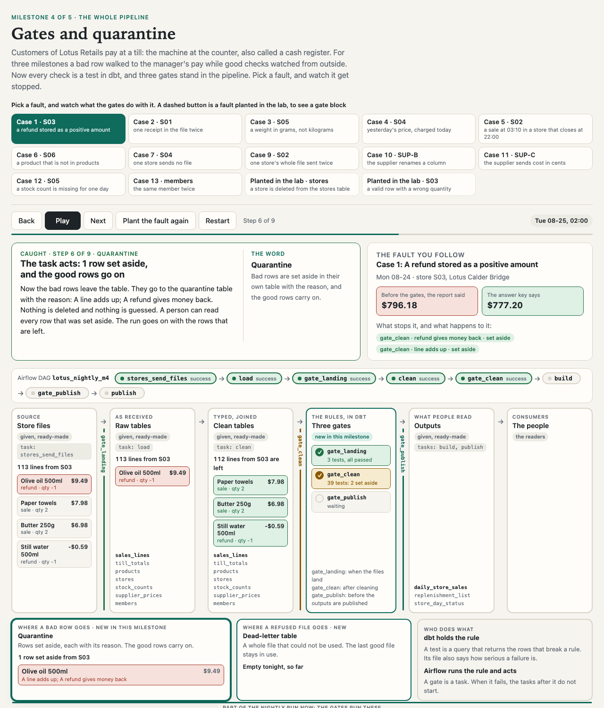 | 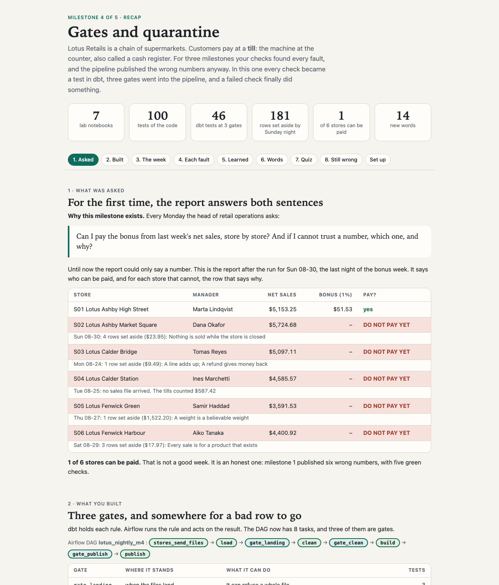 |
| *Milestone 4. The refund stops at a gate and is set aside, with its reason.* | *The recap page of milestone 4.* |

## The check card

This is the method you repeat for every table. Each card is one short page, kept as `checks/<table>.md`, and filled in **before** any check is written.

1. What does one row mean?
2. Who uses this table, and what do they decide with it?
3. How is the data made? So what can go wrong?
4. Which of those would hurt most?
5. What must be prepared before it can be checked?
6. The check: the rule, the limit, the lens, and how serious a failure is.
7. What happens when it fails? And who is told.
8. The proof: plant the fault and show the check catching it.

A check that has no answer to question 2 is deleted. All seven tables have a card in [checks/](checks/), starting with [checks/sales_lines.md](checks/sales_lines.md).

## The words you learn

You meet the problem in Lotus's own rows first, and the word second. Each word is shown on real rows and compared with its opposite.

Every word is in [GLOSSARY.md](GLOSSARY.md), with a line you can say in an interview. The theory behind each one is in the [D8Loop Data Pipeline knowledge base](https://www.d8loop.com/modules/knowledge-corner/data-pipeline), in its section Production, Quality & Advanced. The project is the practice. The knowledge base is the theory.

## How every milestone is built

The same standard as Daily Orders and Retail Profit Stack, so if you know one project you know all three.

Each milestone is a **self-contained folder** under `src/`. It imports nothing from another milestone. Code is copied forward on purpose, so you can compare two folders.

```
src/<milestone>/
  README.md               reading order, and how to run it
  docs/                   BRD.md, HLD.md, LLD.md, each with diagrams
  notebooks/              the lab: numbered notebooks, run in order
  lotus_pipeline/         production code
  checks/                 the check cards that exist so far, one .md per table
  dags/                   the Airflow DAG as it stands after this milestone
  dbt_project/            the dbt models and tests, from milestone 4
  tests/                  tests for the production code
  milestone_N_flow.html   the whole pipeline at this milestone, animated
  milestone_N_recap.html  an animated closing page
```

Shared by every milestone:

| Folder or file | Holds |
|---|---|
| [store_systems/](store_systems/) | The stores, the suppliers and the loyalty app. They are the outside world, not part of any pipeline |
| [answer_key/](answer_key/) | The true numbers, and the thirteen planted cases, as files |
| [checks/](checks/) | The newest check cards, and the page that shows them |
| [understand_business/](understand_business/) | The business page |
| [docs/source_data_proposal.md](docs/source_data_proposal.md) | The design of the tables, the planted cases and the answer key |
| `docker-compose.yml`, `docker/` | The warehouse and Airflow |
| `try_it.py` | The two-minute run |

## Set up

The full steps, click by click for macOS, Windows and Linux, are in [milestone 1's README](src/m1_green_checks_wrong_number/#set-up). In short:

```sh
uv sync                        # the virtual environment. Nothing is installed outside the project
docker compose up -d --build   # the warehouse and Airflow. The first time takes 5 to 15 minutes
```

| Port | Used by |
|---|---|
| 5450 | The warehouse: Postgres |
| 8080 | Airflow's page |

Daily Orders uses ports 5440 and 8080. Stop its Airflow before you start this one, or start this one on another port: `LOTUS_AIRFLOW_PORT=8081 docker compose up -d`.

## Shut everything down

Nothing in this project stops by itself. From the project folder:

```sh
docker compose down
```

This stops and removes both containers, and keeps your data. `docker compose ps` should then list no containers. How to delete the data and free the disk space is in [milestone 1's README](src/m1_green_checks_wrong_number/#shut-it-down).

## Run the tests

```sh
cd store_systems && uv run pytest                      # the stores and the answer key
cd src/m1_green_checks_wrong_number && uv run pytest   # milestone 1
cd src/m2_checks_with_a_reason && uv run pytest        # milestone 2
cd src/m3_every_table_is_different && uv run pytest    # milestone 3
cd src/m4_gates_and_quarantine && uv run pytest        # milestone 4: about two minutes, it runs dbt many times
uv run pytest checks                                   # the check cards page, from the project folder
```

Nothing needs to be running. When the warehouse is up, the pipeline tests also run on Postgres.

## Built with

Python, [uv](https://docs.astral.sh/uv/), pandas, PyYAML, DuckDB, Postgres 16, Docker Compose, dbt 1.12 with dbt-postgres and dbt-duckdb, Apache Airflow 3.4 and pytest.

## What this project is not

| Not here | Where it belongs in the series |
|---|---|
| Building the pipeline itself. It is given | Daily Orders |
| Airflow beyond what gates, alerts and a backfill need | Daily Orders, and the Airflow knowledge base |
| Streaming | The clickstream project |
| A lake, or table formats | The lakehouse project |
| A dashboard. Outputs are tables and a printed report | The warehouse project |
| A dedicated quality tool, a paging service, a schema registry. They are shown, not installed | |
| AI | Retail Profit Stack |

## About the data

Everything here is fictional: Lotus Retails, its towns, its stores, its managers, its members, its products and its prices. The rows are generated from a fixed seed, so everyone gets the same numbers. The project does not describe any real company's systems or data.

## Licence

[MIT](LICENSE). Use it, change it, and teach with it.
