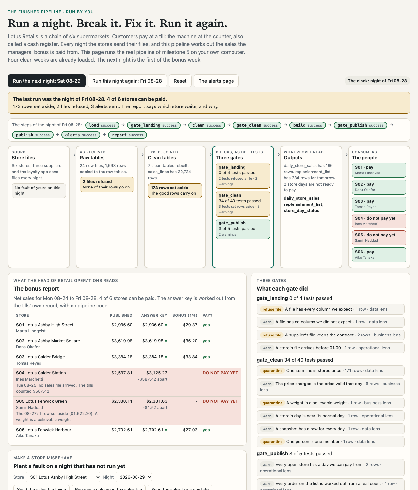
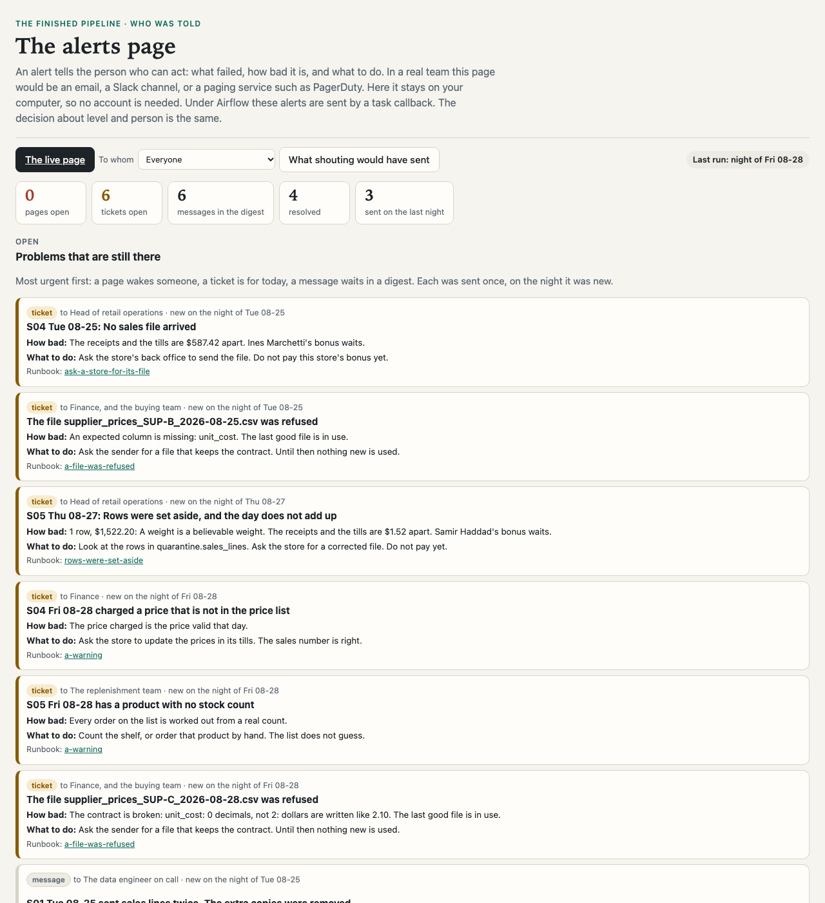

# The live page



Run the finished pipeline night by night, in your browser. Make a store misbehave. Watch a gate catch it. Fix it, run the night again, and hold the number against the answer key.

It runs the real code of [milestone 5](../src/m5_know_alert_recover/): the same load, the same three gates with their dbt tests, the same quarantine, the same alerts.

Lotus Retails is a fictional chain of six supermarkets. Customers pay at a till: the machine at the counter, also called a cash register.

## Start it

**Nothing else needs to be running.** No Docker, no Postgres, no Airflow. From the project folder, once:

```sh
uv sync
```

Then:

```sh
uv run python pipeline_live/server.py
```

It loads four clean weeks, which takes a few seconds. Then your browser opens http://127.0.0.1:8040 . The commands are the same on macOS, Linux and Windows.

| Page | Address | What it shows |
|---|---|---|
| The live page | http://127.0.0.1:8040 | The pipeline, the gates, the bonus report |
| The alerts page | http://127.0.0.1:8040/alerts | Who was told, how urgently, and what to do |

To use another port: `LOTUS_LIVE_PORT=8050 uv run python pipeline_live/server.py`. On Windows: `$env:LOTUS_LIVE_PORT=8050; uv run python pipeline_live/server.py`.

## Stop it

Press **Ctrl+C** in its terminal.

Everything it made is in the folder `data/live/`. It touches nothing else: not the milestones' databases, not Docker. Delete `data/live/` any time.

## The buttons

| Button | What it does |
|---|---|
| **Run the next night** | The stores send that night's files, and the whole pipeline runs: load, three gates, publish, alerts, report |
| **Run this night again** | Runs the newest night again. A file that did not change is skipped. A corrected file is loaded again |
| **Reset** | Back to the start: no faults, and four clean weeks loaded. The next night is Monday 2026-08-24 |
| The five fault buttons | A store misbehaves on a night that has not run yet: its file twice, a renamed column, a late file, impossible prices, or no file |
| **Switch off my faults** | The stores send corrected files |
| **Fix a planted case** | One of the thirteen planted faults is fixed at its source |

A night takes a few seconds. The buttons wait until it is done.

## What you see after a night

| Part of the page | Shows |
|---|---|
| The steps | Each step of the run, with its state. When a gate blocks, the steps after it are "not started" |
| The six stages | The same picture as the flow pages, with tonight's numbers |
| The bonus report | Each store's published number beside the answer key. Pay, or do not pay yet, and why |
| What each gate did | The tests that failed, and what each failure did: block, set aside, refuse a file, or warn |
| Quarantine | The rows that were set aside, with the reason. A member is shown by number only |
| Dead-letter table | Files that were refused whole |
| Who was told | The alerts of that night. And how many alerts shouting would have sent |
| Is the pipeline healthy? | Did it run, on time, with fresh data. Then the run history |

## Things to try

1. **Watch the week.** Run the next night seven times. After Monday one store waits. After Sunday five stores wait, and each has one line that says why.
2. **A file arrives twice.** Reset. Choose a store and the next night, send its file twice, and run. The copies are set aside, and the store is still paid.
3. **A column is renamed.** The landing gate refuses the whole file. One store waits, and five are published.
4. **A file is a day late.** Run two nights. The first night a ticket is sent. The second night it is closed.
5. **Impossible prices.** More than 5% of the file is bad, so all of it is set aside.
6. **Recover.** Switch off your faults, then run this night again. The number equals the answer key.
7. **The Monday answer.** Run all seven nights. Fix cases 1, 3, 5 and 6. Run this night again. Five stores turn to "yes". `S04` stays "no": its Tuesday file never came.

## The alerts page



In a real team an alert is an email, a message in Slack, or a call from a paging service such as PagerDuty. Here it is a page on your own computer, and a file, `alerts.log`, under `data/live/`. So no account is needed.

Each alert says to whom it went, what failed, how bad it is and what to do, with a link to its section of the [runbook](../src/m5_know_alert_recover/RUNBOOK.md). Press **What shouting would have sent** to see the other way: one alert for every failed test, to everyone.

Under Airflow the same alerts are sent by a task callback. That is milestone 5.

## Run its tests

From the project folder:

```sh
uv run pytest pipeline_live
```

About half a minute. The tests start their own server on a free port, with their own data folder.

## Files

| File | Holds |
|---|---|
| `server.py` | The small web server. It runs the pipeline and answers the pages. Python's standard library only |
| `index.html` | The live page |
| `alerts.html` | The alerts page |
| `test_live.py` | Tests of the server and the two pages |
