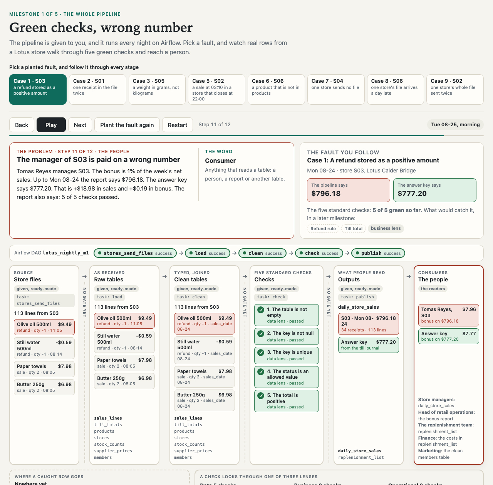

# Milestone 1: Green checks, wrong number

**Status:** Done. Design documents, lab notebooks, production code, tests, flow page and recap page are complete.

This folder is self-contained. Nothing in it imports from another milestone.



## Why this milestone exists

Lotus Retails is a chain of supermarkets. Customers pay at the tills. A **till** is the machine at the counter where a customer pays. It is also called a cash register.

Lotus pays each store manager a bonus from the store's net sales. A pipeline works that number out every night. It has five checks, and they are green every night. So everybody trusts the number.

Nobody has ever asked what those five checks protect.

**What you build:** nothing that changes the pipeline. The pipeline is given to you, ready-made. You run it, you work one store's number out by hand, and you find they differ. Then you do the work that comes **before** a check: who uses each table, what happens to them when it is wrong, what one row means, and what is really in the table.

**The outcome:** for the night of Monday 2026-08-24 the pipeline says store `S03` sold $796.18, with 5 of 5 checks passed. The store's own receipts say $777.20. You find the row that causes it: a refund of $9.49 stored as a positive amount. You rank the seven tables by harm, and you fill in the first check card.

## The numbers

| Notebooks | Tests | Tables | Standard checks | Airflow tasks | Gates | Rows set aside | New words |
|---|---|---|---|---|---|---|---|
| 8 | 100 | 7, and 2 outputs | 5, all green | 5 | 0 | 0 | 12 |

Gates and rows set aside are zero on purpose. They arrive in milestone 4.

## Read it in this order

1. **[milestone_1_flow.html](milestone_1_flow.html)**: open it in a browser first, to see where you are going.
2. [docs/BRD.md](docs/BRD.md): what the business needs and why.
3. [docs/HLD.md](docs/HLD.md): the pipeline you are given, and what this milestone adds.
4. [docs/LLD.md](docs/LLD.md): the exact tables, the SQL of the five checks, the commands. Keep it open for the next two steps.
5. The notebooks in `notebooks/`, from `01` to `08`.
6. The code in `lotus_pipeline/` and `tests/`.
7. [checks/sales_lines.md](checks/sales_lines.md): the first check card.
8. **[milestone_1_flow.html](milestone_1_flow.html)** again, to check what you learned.
9. [milestone_1_recap.html](milestone_1_recap.html): a look back, and three questions.

## What is in this folder

| Folder or file | Holds |
|---|---|
| [docs/](docs/) | [BRD](docs/BRD.md), [HLD](docs/HLD.md) and [LLD](docs/LLD.md), each with diagrams |
| `notebooks/` | The lab: eight notebooks, run in order, plus `lab_helpers.py` |
| `lotus_pipeline/` | The given pipeline (`load`, `clean`, `checks`, `publish`, `report`) and this milestone's code (`by_hand`, `consumers`, `profile`) |
| `checks/` | The check cards that exist so far: `sales_lines.md` |
| `dags/` | The Airflow DAG: `lotus_nightly_m1` |
| `airflow_tools.py` | Drive Airflow from Python. Notebook 2 and one test use it |
| `tests/` | Tests for the production code |
| [milestone_1_flow.html](milestone_1_flow.html) | The whole pipeline at this milestone, animated, with real rows |
| [milestone_1_recap.html](milestone_1_recap.html) | The closing page |

## Set up

Take this slowly. It is the hardest part of the project, and you do it once. After every step there is one command that proves the step worked.

**Tested on:** macOS with Docker Desktop. The Windows and Linux steps follow Docker's own instructions, and I have not run them on a clean machine. If a screen looks different, trust the screen.

### What you need, and how big it is

| Thing | Size | Time |
|---|---|---|
| Git, Python 3.12 or later, [uv](https://docs.astral.sh/uv/) | Small | A few minutes |
| Docker | About 2 GB to install | 10 to 20 minutes |
| The Airflow image | About 3.3 GB to download | 5 to 15 minutes, once |
| The Postgres image | About 0.7 GB | A minute, once |
| Memory for Docker | At least 4 GB. Airflow uses about 1.5 GB | |
| Free disk | 8 GB is comfortable | |

The first start downloads about 4 GB. A long wait with little on the screen is normal. It only happens once.

**No Docker yet, and you want to see something first?** From the project folder, `uv sync` and then `uv run python try_it.py`. That needs no Docker.

### Step 1: Git and uv

| System | Install uv |
|---|---|
| macOS, Linux | `curl -LsSf https://astral.sh/uv/install.sh \| sh` |
| Windows (PowerShell) | `powershell -ExecutionPolicy ByPass -c "irm https://astral.sh/uv/install.ps1 \| iex"` |

Close the terminal and open a new one. Then, in the project folder:

```sh
uv sync
```

This makes a virtual environment in `.venv` and installs everything into it. Nothing is installed outside the project.

**Prove it:**

```sh
uv run python try_it.py
```

You should see a bonus report for six stores, and the line `Checks: 5 of 5 passed.`

### Step 2: Install Docker

Docker runs a program in a **container**: a small sealed box with everything the program needs. You install Docker once, and Airflow and Postgres then need no installing at all.

#### macOS

1. Open https://www.docker.com/products/docker-desktop/ and download **Docker Desktop for Mac**. Choose **Apple silicon** for a Mac with an M1 chip or newer, or **Intel chip** for an older Mac. To find out which you have: Apple menu, **About This Mac**.
2. Open the downloaded `.dmg` file. Drag the Docker icon onto the Applications folder.
3. Open **Docker** from Applications. macOS asks if you are sure: choose **Open**.
4. Docker asks you to accept its terms: choose **Accept**. It may ask for your Mac's password, to finish the installation.
5. It asks you to sign in. You can choose **Skip**. No account is needed.
6. Wait until the whale icon in the menu bar stops moving. Docker is now running.

#### Windows

Docker on Windows runs inside **WSL 2**, a small Linux that Windows provides. Install WSL 2 first, then Docker.

1. Click Start, type `PowerShell`, right-click **Windows PowerShell**, and choose **Run as administrator**.
2. Type `wsl --install` and press Enter. Windows downloads Ubuntu. Wait until it finishes.
3. **Restart the computer.** This is not optional.
4. After the restart, a window named Ubuntu opens by itself. It asks for a new username and a password. Choose anything, and remember it. The password does not show while you type. That is normal.
5. Open https://www.docker.com/products/docker-desktop/ and download **Docker Desktop for Windows**.
6. Run the installer. On the Configuration screen, keep **Use WSL 2 instead of Hyper-V** ticked. Choose **Ok**.
7. When it finishes, choose **Close and log out**, then log in again.
8. Open **Docker Desktop** from the Start menu. Accept the terms. You can skip the sign-in.
9. Wait until the bottom-left corner of the Docker window says **Engine running**.

Use **PowerShell** for every command in this project. You do not need to work inside Ubuntu.

#### Linux

These lines install Docker Engine with Docker's own script. They are for Ubuntu and Debian. For other systems, follow https://docs.docker.com/engine/install/.

```sh
curl -fsSL https://get.docker.com -o get-docker.sh
sudo sh get-docker.sh
sudo usermod -aG docker $USER
```

The last line lets you run Docker without `sudo`. **Log out and log in again** for it to take effect.

#### Prove it, on every system

```sh
docker --version
docker compose version
docker run --rm hello-world
```

The first two print a version number. The third prints `Hello from Docker!`. If all three work, Docker is installed and running.

### Step 3: Give Docker enough memory

Airflow needs about 1.5 GB. Give Docker at least 4 GB.

| System | Where |
|---|---|
| macOS | Docker Desktop, the gear icon, **Resources**, **Memory**. Set 4 GB or more, then **Apply & restart** |
| Windows | Docker uses WSL's memory, which is half of your computer's by default. With 8 GB or more in the computer you need to change nothing |
| Linux | Docker uses the computer's memory directly. Nothing to set |

**Prove it:**

```sh
docker info --format "{{.MemTotal}}"
```

It prints a number of bytes. It should be above 4000000000.

### Step 4: Start the warehouse and Airflow

From the project folder:

```sh
docker compose up -d --build
```

The first time, this downloads the two images and builds one more on top. Expect 5 to 15 minutes. Lines of text scroll by, and for a while a line may not move. That is the download. Let it finish.

It ends with these lines:

```
 ✔ Container lotus-warehouse  Healthy
 ✔ Container lotus-airflow    Started
```

| Container | What it is | Where |
|---|---|---|
| `lotus-warehouse` | Postgres: the warehouse | port 5450 |
| `lotus-airflow` | Airflow 3.4: scheduler and web page | http://localhost:8080 , no password |

**Prove it:**

```sh
docker compose ps
```

Both containers are listed with the status `Up`. The warehouse also says `(healthy)`.

Airflow needs about half a minute more to wake up. Then open http://localhost:8080 in a browser. You see Airflow's page with one DAG: `lotus_nightly_m1`. No login is asked.

### Step 5: Run one night

```sh
docker compose exec airflow airflow dags unpause lotus_nightly_m1
docker compose exec airflow airflow dags trigger lotus_nightly_m1 --logical-date 2026-08-24T07:00:00+00:00
```

Wait twenty seconds. Reload Airflow's page and click `lotus_nightly_m1`. One run, five green tasks.

**Prove it,** from this milestone's folder:

```sh
uv run python -m lotus_pipeline report --day 2026-08-24
```

You see the bonus report, read from Postgres. Store `S03` is at $796.18.

### Step 6: Open the notebooks

In VS Code, install the **Python** and **Jupyter** extensions. Open a notebook from `notebooks/`, choose **Select Kernel**, then **Python Environments**, and pick this project's `.venv`.

## If something goes wrong

These are the five most likely errors.

### 1. Docker is not running

```
Cannot connect to the Docker daemon at unix:///var/run/docker.sock. Is the docker daemon running?
```

On Windows the message names a pipe: `open //./pipe/dockerDesktopLinuxEngine: The system cannot find the file specified`.

**Fix:** open Docker Desktop and wait until the whale stops moving, or the window says **Engine running**. On Linux: `sudo systemctl start docker`. Then run the command again.

### 2. A port is already in use

```
Error response from daemon: ... Bind for 0.0.0.0:8080 failed: port is already allocated
```

Another program uses port 8080. Daily Orders' Airflow uses it too: stop that first, with `docker compose --profile schedule down` in its folder. Or give this project another port:

| System | Command |
|---|---|
| macOS, Linux | `LOTUS_AIRFLOW_PORT=8081 docker compose up -d` |
| Windows (PowerShell) | `$env:LOTUS_AIRFLOW_PORT=8081; docker compose up -d` |

Airflow's page is then at http://localhost:8081 . If the message names port 5450, use `LOTUS_PG_PORT=5451` in the same way, and set the same variable in the terminal where you run `uv run`.

### 3. Not enough memory

Airflow's page never opens, and this shows the container has stopped:

```sh
docker compose ps -a
```

```
lotus-airflow   ...   Exited (137)
```

Code 137 means the container was stopped because memory ran out.

**Fix:** give Docker more memory (step 3). Close other heavy programs. Then `docker compose up -d`.

### 4. The build stopped halfway

```
failed to solve: ... unexpected EOF
```

or `TLS handshake timeout`, or `no space left on device`. The download was cut off, or the disk is full.

**Fix:** run `docker compose up -d --build` again. Docker keeps the parts it already has, so it goes on where it stopped. For a full disk, see "Free the disk space" below, then try again.

### 5. Airflow's page does not open

The browser says the site cannot be reached.

1. Wait one minute, and reload. Airflow starts slower than its container.
2. `docker compose ps`: is `lotus-airflow` listed as `Up`? If not, see error 3.
3. `docker compose logs airflow --tail 30`: read the last lines. `Application startup complete.` means Airflow is ready.
4. Use `http://localhost:8080`, with `http` and not `https`.

Still stuck? `docker compose down`, then `docker compose up -d`, and wait a minute.

## Shut it down

Nothing in this project stops by itself. When you are done, stop what you started. Run these from the project folder.

| You started | It keeps running | Stop it with |
|---|---|---|
| `docker compose up -d --build` | Two containers: the warehouse (5450) and Airflow (8080) | `docker compose down` |
| A notebook | A Python kernel | Close the notebook, or **Shut Down Kernel** in VS Code |

**Prove it:** `docker compose ps` lists no containers.

`down` stops and removes the containers, and **keeps your data**. The next `docker compose up -d` finds the warehouse as you left it, and it starts in seconds.

To pause without removing anything, use `docker compose stop`, and later `docker compose start`.

### Free the disk space

| To remove | Command | What you lose |
|---|---|---|
| The warehouse data and the stores' files | `docker compose down -v` | Every table. The next run starts empty |
| The Airflow images, about 3.3 GB | `docker rmi lotus-airflow:3.4.0 apache/airflow:3.4.0` | Nothing but disk space. The next start downloads them again. Keep `apache/airflow:3.4.0` if you also use Daily Orders |
| The Postgres image, about 0.7 GB | `docker rmi postgres:16` | The same |
| Leftovers of the build | `docker builder prune` | Nothing |
| The files made on your computer | Delete the `data` folder in the project | Nothing. They are made again |
| The virtual environment | Delete the `.venv` folder | Nothing. `uv sync` makes it again |

To see how much disk Docker uses: `docker system df`.

## The lab

Open the notebooks in VS Code, choose the project's `.venv` as the kernel, and run them in order. Each takes about ten minutes.

| Notebook | What you do | New words | Needs |
|---|---|---|---|
| `01_the_question_and_five_green_checks` | Meet Lotus Retails and the Monday question. Run the pipeline for one night. Read its five checks | Data quality, check | The warehouse |
| `02_airflow_runs_it` | Let Airflow run the same night. Read the DAG | DAG, task, dependency | Airflow |
| `03_the_number_by_hand` | Add up one store's receipts yourself. Find out why the two numbers differ | Silent failure | The warehouse |
| `04_who_is_hurt` | For each table: who uses it, and what happens to them when it is wrong | Consumer, impact, critical table | The warehouse |
| `05_the_check_card` | Meet the page you fill in before any check. Say what one row means | Grain | The warehouse |
| `06_read_the_table_first` | Count the rows, find the smallest and largest values, count the empty cells | Profiling | The warehouse |
| `07_six_questions_for_any_table` | Sort your worries under six questions. See which ones the five checks answer | The six dimensions | The warehouse |
| `08_the_production_version` | The same logic as a tested program | | The warehouse |

Notebook 3 saves `notebooks/results/answer_key_by_hand.json`. Notebook 8 and one test read it, so run the notebooks in order the first time.

## Run it from a terminal

From this folder. Each line is one step of the pipeline, and Airflow starts exactly these.

```sh
uv run python -m store_systems deliver --through 2026-08-24   # the stores send their files
uv run python -m lotus_pipeline run --day 2026-08-24          # load, clean, check, publish, report
```

Three commands only look, and change nothing:

```sh
uv run python -m lotus_pipeline by-hand --store S03 --day 2026-08-24   # add up one store's file
uv run python -m lotus_pipeline impact                                 # the seven tables, ranked by harm
uv run python -m lotus_pipeline profile --table clean.sales_lines      # read a table before checking it
```

The first prints:

```
S03 on 2026-08-24
  the pipeline says        $796.18
  by hand, from file       $777.20
  the tills' own total     $777.20
  difference                $18.98
  look at line S03-0824-000008: a refund of $9.49, and the amount is not negative
```

These commands use the warehouse in Docker. To use a database in one file, with nothing running, set `LOTUS_WAREHOUSE=duckdb` first.

## Run the tests

```sh
uv run pytest
```

About half a minute. The tests use their own files and their own database, never yours. They run on DuckDB, so nothing needs to be running. When the warehouse is up, the pipeline tests run a second time on Postgres. When Airflow is up, one more test asks the real Airflow to read the DAG.

**Every check has two tests:** one where its fault is planted and the check fails, and one on clean data where it stays silent.

## The pages show real numbers

No number on the flow page or the recap page is typed by hand. A script runs the real pipeline for the whole bonus week and writes what happened into the pages. A test fails when a page is out of date.

```sh
uv run python -m lotus_pipeline.flow_data
```

## Five things you learn

1. Green checks do not mean right data.
2. A check needs a reason: who uses the table, and what goes wrong for them.
3. Rank the tables by harm before you write any check.
4. Say what one row means, then read the table, before you check it.
5. Work the number out by hand. Without an answer key you cannot tell a right number from a wrong one.

## New words

| Word | Meaning |
|---|---|
| **Data quality** | Data quality means the data is good enough to trust |
| **Check** | A check is a query that looks for bad rows. No rows means the data passes |
| **DAG** | The list of a pipeline's tasks and the order they run in. Airflow draws it as boxes and arrows |
| **Task** | One step of the pipeline that Airflow starts, such as `load` |
| **Dependency** | An arrow between two tasks. The second waits for the first, and does not run if the first fails |
| **Silent failure** | Wrong data with no error. Every task succeeds, and a wrong number reaches the reader |
| **Consumer** | Anything that reads a table: a person, a report or another table |
| **Impact** | Everything a wrong table touches: the tables built from it and the people who read them. Also called blast radius |
| **Critical table** | A table where a wrong value costs someone money or a decision. It gets the most checks |
| **Grain** | What one row of a table means |
| **Profiling** | Reading a table before you check it: count the rows, find the smallest and largest values, count the empty cells |
| **The six dimensions** | Six questions for any table: is it complete, unique, valid, accurate, consistent and fresh? |

Each word has an interview line in the project's [GLOSSARY.md](../../GLOSSARY.md).

## Test yourself

**1. It is Monday 08-24, at night. All five checks pass. The head of retail operations asks: so the numbers are right? What do you say?**

No. Green checks only answer the five questions they ask. None of them asks whether a refund is negative. Store `S03` is $18.98 too high tonight, with five green checks.

**2. A teammate wants a not-null check on `member_id` in `sales_lines`, because empty cells are bad. What do you ask first?**

Who uses `member_id`, and what goes wrong for them when it is empty? A customer may pay without a loyalty card. On Monday 08-24, 377 of 610 lines have no member, and all of them are right. A check with no answer to that question is deleted.

**3. Store `S04` sends no sales file on Tuesday 08-25. Which of the five standard checks fails?**

None. The other stores sent their lines, so the table is not empty. `S04` has no rows, and a row that is not there cannot fail a check. A whole day of $587.42 is missing, and the run is green.

## Still wrong

> We found one error by luck, and we have a list of worries. We have no checks that would have caught it.

The pipeline is exactly as it was. Tomorrow night the same refund would pass again. Milestone 2 writes the checks.
