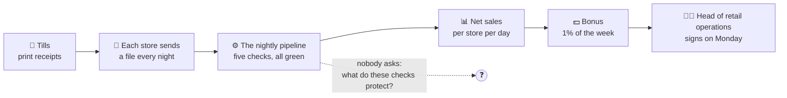

# BRD: Milestone 1, Green checks, wrong number

**Status:** Final; built
**Milestone:** 1 of 5 (see the project [README](../../../README.md#milestones))

> **What this document is.** A business requirements document (BRD) says what the business needs and why. It uses business words and no technology. Read it first. Next, read the [HLD](HLD.md) to see what is built.

## 1. The business problem

Lotus Retails is a fictional chain of supermarkets. It has six stores in three towns. Customers pay at the tills in the store. A **till** is the machine at the counter where a customer pays. It is also called a cash register.

Every store manager is paid a weekly bonus: **1% of the store's net sales**. Net sales are the money taken for sales, less the money given back for refunds.

Every night a pipeline adds up each store's sales. It has five checks, and they pass every night. Lotus trusts the number because the checks are green.

On Monday 2026-08-24, store `S03` is reported at **$796.18**. Its own receipts add up to **$777.20**. Nothing failed. Nobody was told.

## 2. The question to answer

Every Monday the head of retail operations signs off the bonus. She asks:

> Can I pay the bonus from last week's net sales, store by store? And if I cannot trust a number, which one, and why?

Today nobody can answer the second sentence. This milestone shows why. It does not fix it yet.

## 3. The people

Four groups use the data, and one person signs for it. Each is hurt in a different way.

| Who | What they read | What they do with it | What a wrong value does |
|---|---|---|---|
| 🏬 Store managers | Net sales of their store | They are paid from it | Wrong pay |
| 👩‍💼 Head of retail operations | Net sales of every store | She signs off the bonus | She signs a wrong number |
| 🚚 The replenishment team | The order list | They order tomorrow's stock | Too high wastes food. Too low leaves empty shelves |
| 💰 Finance | The order list, and the suppliers' prices | They pay suppliers | Wrong money leaves the company |
| 📣 Marketing | The loyalty members | They send emails | Two emails to one person. An email to a stranger |
| 🎓 Learner | All of it | Learns to ask who is hurt before writing a check | |

## 4. What the business has today

Seven kinds of data arrive every night. They are made in seven different ways.

| Data | What one row is | Made by |
|---|---|---|
| Sales lines | One item line on one receipt | Each till. Each store sends a file |
| Till totals | One till's own total for one day | The till, when it is closed |
| Products | One product at one price | The buying team types it |
| Stores | One store, with its opening hours | Typed once |
| Stock counts | One product in one store on one day | Counted by hand or by scanner |
| Supplier prices | One product's cost from one supplier | A file the supplier sends |
| Members | One loyalty member | The customer types it in an app |

The pipeline turns them into two tables that people read:

| Table | What one row is | Read by |
|---|---|---|
| Daily store sales | One store on one day, with net sales | Store managers, head of retail operations |
| Replenishment list | One product in one store, with how much to order | The replenishment team, finance |

## 5. Business rules

| Rule | Decision |
|---|---|
| Net sales | Money taken for sales, less money given back for refunds |
| A refund | Money given back. It makes net sales smaller |
| The business day | The day the store was open |
| The bonus | 1% of the store's net sales, Monday to Sunday, rounded to a cent |
| Sign-off | Monday, for the week before |
| The nightly run | 02:00, for the day that just ended. Files are due by 01:00 |
| The replenishment rule | Order twice what sold yesterday, less what is on the shelf. Never below zero |
| Money | Whole cents, US dollars. Prices include tax |

## 6. What this milestone must deliver

1. The pipeline, running on the learner's own computer, for the night of Monday 2026-08-24.
2. One store's net sales worked out by hand from its receipts, beside the pipeline's number.
3. The cause of the difference, shown on the row.
4. For each of the seven kinds of data: who uses it, and what happens to them when it is wrong.
5. The seven ranked by harm.
6. A **check card** for sales lines, with its first five questions answered.
7. A list of worries about sales lines, each one a candidate for a check.

## 7. Scope

**In scope:** understand the pipeline, find one wrong number, and decide what is worth checking.

**Out of scope for this milestone:**

| Not yet | Arrives in |
|---|---|
| Writing the checks for sales lines | Milestone 2 |
| Check cards and checks for the other six kinds of data | Milestone 3 |
| Stopping a bad night, and setting bad rows aside | Milestone 4 |
| Alerts, run history and recovery | Milestone 5 |

Never in this project: building the pipeline itself, a dashboard, streaming, a cloud account, AI.

## 8. Success criteria

- The pipeline reports `S03` at **$796.18** for 2026-08-24, with **5 of 5** checks passed.
- The learner's own count from the receipts is **$777.20**. It equals the tills' own total and the answer key.
- The difference, **$18.98**, is explained by one row: a refund of $9.49 stored as a positive amount.
- The seven tables are ranked by harm, and three are named critical.
- The check card for sales lines names its readers and ranks six worries. One worry gets no check, with a reason.

## 9. Assumptions

- All data is fictional and generated. It does not describe any real company.
- Every learner gets the same rows, so every number in this document can be reproduced.
- The answer key is worked out from the tills' own record, by code that shares nothing with the pipeline.
