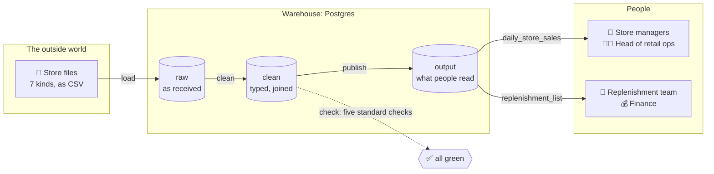
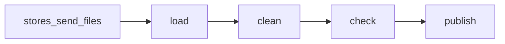
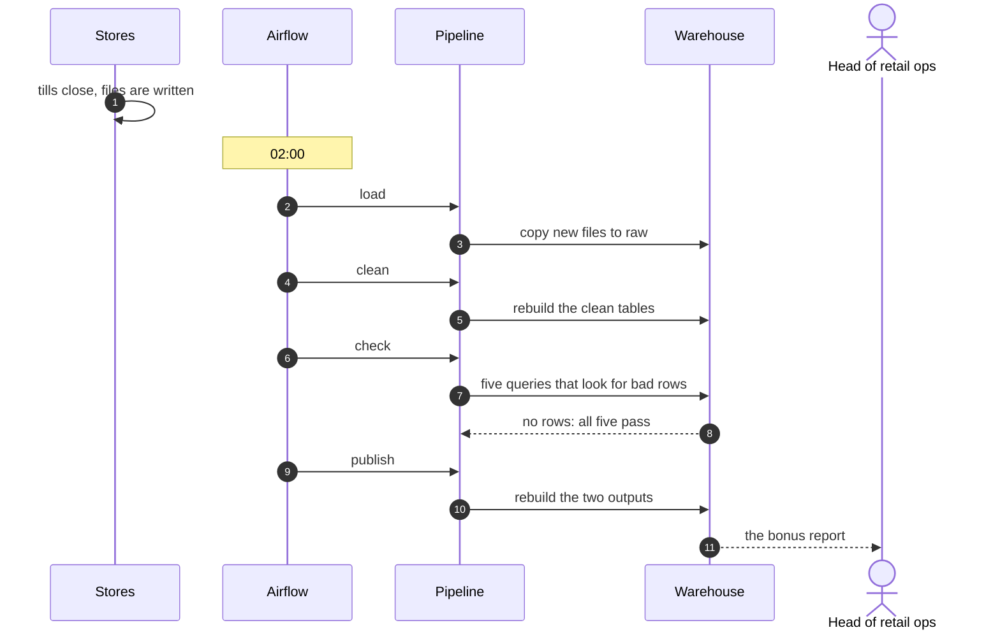
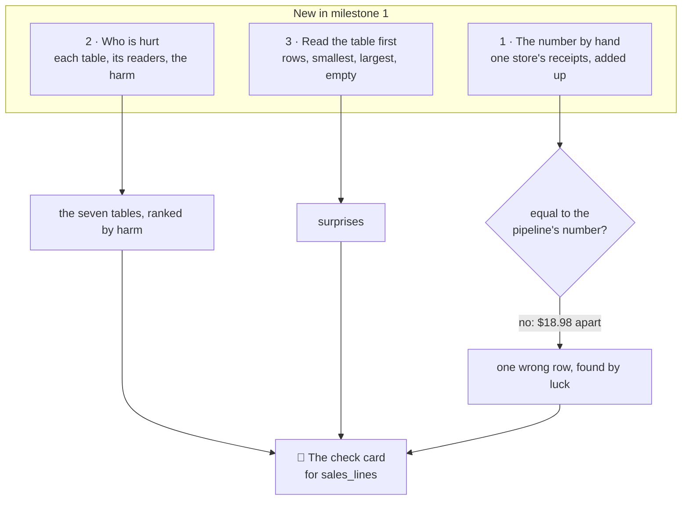

# HLD: Milestone 1, Green checks, wrong number

**Status:** Final; built
**Satisfies:** [BRD](BRD.md)

> **What this document is.** A high-level design (HLD) names the parts of the system, what each part does, and how data moves between them. It gives no exact columns or functions. Read it after the [BRD](BRD.md). The [LLD](LLD.md) then gives the exact detail.

## 1. The pipeline you are given

You do not build this pipeline. It is ready-made, and it runs every night. Your hours go into its quality.

| Stage | Holds | State in this milestone |
|---|---|---|
| Store files | What the stores, the suppliers and the loyalty app send | Given |
| Raw tables | Every file, copied as it arrived. Every value is text | Given |
| Clean tables | The same rows with types, and joined to products and stores | Given |
| Checks | Five standard checks | Given. All green |
| Outputs | `daily_store_sales` and `replenishment_list` | Given |
| Gates, quarantine, alerts | Nothing | ❌ Not yet |

## 2. Airflow runs it

The pipeline is five commands. Apache Airflow starts them, one after the other, every night at 02:00.

Three words are enough to read that picture.

| Word | Meaning | Here |
|---|---|---|
| **DAG** | The list of a pipeline's tasks and the order they run in | `lotus_nightly_m1` |
| **Task** | One step that Airflow starts | `load`, `clean`, `check`, `publish` |
| **Dependency** | An arrow between two tasks. The second waits for the first, and does not run if the first fails | `check` → `publish` |

That last arrow is the only safety the pipeline has. If a check fails, `publish` does not run. So everything depends on what the five checks can see.

**Airflow holds no business logic.** Each task starts a command that you can also type yourself. The first task is special: the stores in this project are a small program, so a task makes them send their files. Real stores send by themselves.

The full story of Airflow is in [Daily Orders](https://github.com/vijaysngrajput/daily-orders-api-to-warehouse) and in the [Airflow knowledge base](https://www.d8loop.com/modules/knowledge-corner/airflow). This project uses only what the checks need.

## 3. One night, step by step

## 4. What this milestone adds

No check, and no gate. It adds the three things that come **before** a check.

| Part | What it does | Does not do |
|---|---|---|
| **By hand** | Adds up one store's file: every sale, less every refund. Holds the result against the pipeline and against the tills' own total | Read any table the pipeline made, except its final number |
| **Consumers** | Holds the map of what reads what, and who reads each output. Says who is hurt when one table is wrong. Ranks the seven tables | Look at any data |
| **Profile** | Reads a table: rows per store per day, smallest and largest values, empty cells | Decide what is wrong. A person decides |
| **Check card** | One page per table, filled in before a check is written | Hold any SQL yet |

## 5. Key design decisions

| Decision | Reason |
|---|---|
| The pipeline is given, not built | The reader is a beginner. Building a pipeline is Daily Orders. Here the hours go into quality |
| The hand count shares no code with the pipeline | Two counts made by the same code agree even when both are wrong |
| A refund is "money given back", whatever its sign | That is how a person reads a receipt. It is why the hand count is right where the pipeline is wrong |
| The readers of a table decide its rank | A check protects a person. A table nobody reads needs few checks |
| A table is critical when a fault reaches three or more groups | A simple rule that anyone can repeat |
| The check card comes before the check | Writing the reason first stops the "same five checks on every table" habit |
| Postgres under Airflow, DuckDB for the two-minute run | A first try must not need Docker. The same SQL runs on both, and a test proves it |

## 6. The three lenses

A check looks through one of three lenses. All five standard checks use the same one.

| Lens | It tests | The five standard checks |
|---|---|---|
| **Data** | The values themselves: empty, twice, not allowed | All five |
| **Business** | A rule of how the company works: a refund gives money back | None |
| **Operational** | The pipeline: did every store send a file, on time | None |

The planted refund breaks a business rule. No data check can see it. Its key is there, its key is unique, its status is allowed, and the store's total is above zero.

## 7. What this design costs

| Cost | What happens | Fixed in |
|---|---|---|
| The wrong number was found by luck | We happened to add up `S03`. Five other stores were not looked at | Milestone 2 |
| A worry is not a check | The check card lists six worries. Nothing tests them | Milestone 2 |
| One table has a card | Six more tables are nothing like it | Milestone 3 |
| A failed check would only stop the night | No row is set aside, and nobody is told | Milestones 4 and 5 |

## 8. Technology

Python 3.12, Postgres 16 in Docker, Apache Airflow 3.4 in Docker, DuckDB for the two-minute run, pandas in the notebooks, pytest for tests. The stores are a small program in the shared [`store_systems/`](../../../store_systems/) folder.

**Docker and Airflow are new in this milestone.** The [README](../README.md#set-up) installs them click by click.

## 9. Risks

| Risk | Handling |
|---|---|
| Docker is hard to install | Click-by-click steps for macOS, Windows and Linux, a proof after every step, and the five most likely errors |
| The learner has no Docker yet | The two-minute run and the tests need none. They use DuckDB |
| The hand count and the pipeline agree by accident | The hand count is also held against the answer key, in a test |
| The map of what reads what goes out of date | A test compares it with the pipeline's SQL |
