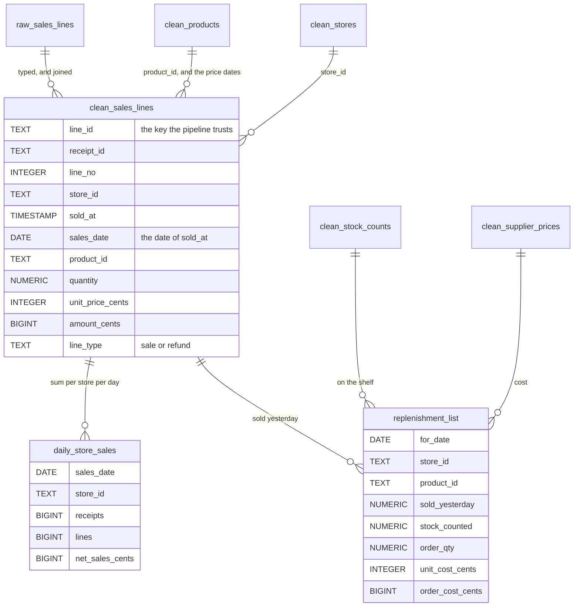

# LLD: Milestone 1, Green checks, wrong number

**Status:** Final; built
**Fits inside:** [HLD](HLD.md)

> **What this document is.** A low-level design (LLD) gives the exact detail of each part named in the [HLD](HLD.md): the files, the tables, the SQL of every check, the commands and the tests. Keep it open beside the notebooks and the code. Section 11 says which notebook and which file build each part.

## 1. Files

Everything is inside `src/m1_green_checks_wrong_number/`. Nothing imports from another milestone.

```
docs/                     BRD.md, HLD.md, LLD.md
notebooks/                the lab: eight notebooks, run in order
  lab_helpers.py          small helpers the notebooks share
  results/                what the notebooks save
lotus_pipeline/           production code
  config.py               the landing folder, the warehouse, the bonus rate
  warehouse.py            one small class that talks to Postgres or DuckDB
  load.py                 given: step 1, files → raw tables
  clean.py                given: step 2, raw → clean tables
  checks.py               given: step 3, the five standard checks
  publish.py              given: step 4, clean → the two outputs
  report.py               given: the bonus report
  pipeline.py             given: one night, start to end, and the command line
  by_hand.py              new: one store's net sales, added up from its file
  consumers.py            new: who uses each table, and the ranking by harm
  profile.py              new: read a table before checking it
  flow_data.py            builds the numbers shown on the flow page and the recap page
checks/sales_lines.md     the check card, questions 1 to 5
dags/lotus_nightly_dag.py the Airflow DAG
airflow_tools.py          drive Airflow from Python: the notebooks and one test use it
tests/                    one test file per code file
milestone_1_flow.html     the whole pipeline, animated
milestone_1_recap.html    the closing page
```

The stores are shared by all milestones. They are in [`store_systems/`](../../../store_systems/) at the project root.

## 2. The source: what arrives

The stores write CSV files into a **landing folder**, one sub-folder per table.

| Table | File name | How often | Rows in one file |
|---|---|---|---|
| `sales_lines` | `sales_lines_S03_2026-08-24.csv` | One per store, per night | About 110 |
| `till_totals` | `till_totals_S03_2026-08-24.csv` | One per store, per night | 2 |
| `stock_counts` | `stock_counts_S03_2026-08-24.csv` | One per store, per night | 39 |
| `products` | `products_2026-08-24.csv` | The whole table, every night | 41 |
| `stores` | `stores_2026-08-24.csv` | The whole table, every night | 6 |
| `members` | `members_2026-08-24.csv` | The whole table, every night | 302 |
| `supplier_prices` | `supplier_prices_SUP-A_2026-08-24.csv` | One per supplier, per week | 12 to 15 |

`_arrivals.csv` in the landing folder says when each file arrived. The columns of every table are in the [data proposal](../../../docs/source_data_proposal.md#2-the-seven-tables-as-the-stores-send-them).

Two lines of `sales_lines_S03_2026-08-24.csv`. Both are refunds:

| line_id | receipt_id | product_id | quantity | unit_price_cents | amount_cents | line_type |
|---|---|---|---|---|---|---|
| S03-0824-000003 | S03-T1-004491 | P-032 | -1.000 | 59 | **-59** | refund |
| S03-0824-000008 | S03-T1-004493 | P-024 | -1.000 | 949 | **949** | refund |

The first is right. The second is the planted case: the minus sign of the amount is lost.

## 3. The warehouse

Four schemas. A schema is a named group of tables.



| Schema | Holds | After the night of 08-24 |
|---|---|---|
| `raw` | One table per source table, every value as text, plus `_file_name`, `_received_at`, `_loaded_at`. And `loaded_files` | 622 files, 37,710 rows |
| `clean` | The seven tables with types. `sales_lines` is joined to `products` and `stores` | `sales_lines` has 20,482 rows |
| `output` | `daily_store_sales`, `replenishment_list` | 174 rows, and 234 rows for tomorrow |
| `ops` | `check_results`: one row per check per night | 5 rows for the night |

Under Airflow the warehouse is Postgres, in the database `lotus_m1`. The two-minute run and the tests use DuckDB, one file. `warehouse.py` hides the difference.

## 4. The given pipeline

Every step is one command. `--day` is the **business day**: the day the stores were open.

| Step | Command | What it does |
|---|---|---|
| Load | `python -m lotus_pipeline load --day 2026-08-24` | Copies every file that had arrived by 02:00 the next morning and is not loaded yet |
| Clean | `... clean --day 2026-08-24` | Rebuilds the seven clean tables from the raw tables |
| Check | `... check --day 2026-08-24` | Runs the five standard checks. Exit code 1 when one fails |
| Publish | `... publish --day 2026-08-24` | Rebuilds `daily_store_sales`. Writes the order list for the next day |
| Report | `... report --day 2026-08-24` | Prints the bonus report for the week so far |
| All five | `... run --day 2026-08-24` | The five steps in order. Stops at the first that fails |

The two rules that matter most later:

```sql
-- clean.sales_lines: the day of a sale is the date on the till's clock
CAST(CAST(l.sold_at AS TIMESTAMP) AS DATE) AS sales_date

-- output.daily_store_sales: net sales is the sum of the amounts
SELECT sales_date, store_id, sum(amount_cents) AS net_sales_cents
FROM clean.sales_lines
GROUP BY sales_date, store_id
```

The second rule trusts the sign of `amount_cents`. A refund must be negative, or it is added.

## 5. The five standard checks (`checks.py`)

A check is a query that returns the bad rows. No rows means it passes. All five run on `clean.sales_lines`.

| # | Check | Lens | Limit | What a failure does |
|---|---|---|---|---|
| 1 | The table is not empty | Data | At least one line for the run's day | The `check` task fails. `publish` does not run |
| 2 | The key is not null | Data | No `line_id` is empty | The same |
| 3 | The key is unique | Data | No `line_id` is there twice | The same |
| 4 | The status is an allowed value | Data | `line_type` is `sale` or `refund` | The same |
| 5 | The total is positive | Data | Each store's day adds up to more than zero | The same |

```sql
-- 1. The table is not empty
SELECT 'no sales lines for this day' AS problem
WHERE NOT EXISTS (SELECT 1 FROM clean.sales_lines WHERE sales_date = ?);

-- 2. The key is not null
SELECT * FROM clean.sales_lines WHERE line_id IS NULL;

-- 3. The key is unique
SELECT line_id, count(*) AS times
FROM clean.sales_lines GROUP BY line_id HAVING count(*) > 1;

-- 4. The status is an allowed value
SELECT * FROM clean.sales_lines
WHERE line_type IS NULL OR line_type NOT IN ('sale', 'refund');

-- 5. The total is positive
SELECT sales_date, store_id, sum(amount_cents) AS net_sales_cents
FROM clean.sales_lines GROUP BY sales_date, store_id HAVING sum(amount_cents) <= 0;
```

Check 5 is on a store's day, not on a line. A refund line is negative on purpose, so a line check would fail on good data.

### What each check says about the planted refund

| # | Check | The row `S03-0824-000008` | Result |
|---|---|---|---|
| 1 | Not empty | `S03` has 113 lines that day | ✅ |
| 2 | Key not null | `line_id` is there | ✅ |
| 3 | Key unique | No other row has it | ✅ |
| 4 | Status allowed | `refund` is allowed | ✅ |
| 5 | Total positive | The store's day is $796.18, above zero | ✅ |

Five checks looked at the table. None asked what a refund is.

## 6. The DAG (`dags/lotus_nightly_dag.py`)

| Setting | Value | Why |
|---|---|---|
| `dag_id` | `lotus_nightly_m1` | One DAG per milestone, so two can be compared |
| Schedule | 02:00 every night | The stores' files are due by 01:00 |
| The run's day | `{{ ds }}`, the run's logical date | Each run is **for** one business day |
| `catchup` | `False` | A person asks for the nights they want |
| `max_active_runs` | 1 | Two nights must never write the same tables together |
| Retries | 0 | A check that failed on the data will fail again |

```
stores_send_files  >>  load  >>  clean  >>  check  >>  publish
```

Start one night by hand, from the project folder:

```sh
docker compose exec airflow airflow dags trigger lotus_nightly_m1 --logical-date 2026-08-24T07:00:00+00:00
```

Or press **Trigger** on the DAG's page at http://localhost:8080 and choose the logical date 2026-08-24.

## 7. The number by hand (`by_hand.py`)

| Function | Returns |
|---|---|
| `read_lines(store_id, day)` | Every line of the file one store sent |
| `net_sales_by_hand(lines)` | Sales, refunds and net sales, in cents |
| `till_total(store_id, day)` | The tills' own total, from `till_totals` |
| `compare(wh, store_id, day)` | The pipeline's number, the hand count, the tills' total, the difference, and the suspect lines |

The rule of the hand count, in two lines:

```python
sales   = sum(amount for a line with line_type "sale")
refunds = sum(abs(amount) for a line with line_type "refund")   # money given back, whatever its sign
```

Result for `S03` on 2026-08-24:

| Count | Net sales |
|---|---|
| The pipeline, `daily_store_sales` | $796.18 |
| By hand, from the file | $777.20 |
| The tills' own total, `till_totals` | $777.20 |
| Difference | $18.98, which is 2 × $9.49 |

A refund stored as +949 is counted as +949 where it should be −949. So the error is twice the refund.

## 8. Who is hurt (`consumers.py`)

Three maps, typed by hand from the BRD and from the pipeline's SQL.

| Map | Holds |
|---|---|
| `BUILT_FROM` | For each clean table and each output: the tables it is built from. A test compares it with the SQL |
| `CONSUMERS` | Five groups of people: what they read, what they decide, what a wrong value costs them |
| `MADE_BY` | How each of the seven source tables is made |

| Function | Returns |
|---|---|
| `downstream(table)` | Every table built from it, directly or through another table |
| `impact(source_table)` | The tables a fault reaches, the outputs, and the people |
| `rank_tables()` | The seven tables, the most harmful first |

The ranking rule: count the groups of people a fault reaches. A table is **critical** when it reaches three or more.

| Rank | Table | Reaches | Critical |
|---|---|---|---|
| 1 | `sales_lines` | Store managers, head of retail operations, the replenishment team, finance | Yes |
| 2 | `products` | The same four. A product that does not join drops the sales line | Yes |
| 3 | `stores` | The same four. Six rows, and wrong here is wrong everywhere | Yes |
| 4 | `stock_counts` | The replenishment team, finance | |
| 5 | `supplier_prices` | The replenishment team, finance | |
| 6 | `members` | Marketing | |
| 7 | `till_totals` | Nobody. No output reads it | |

`till_totals` is last, and it is the most useful table for checking. It is a second count of the same money. Milestone 2 uses it.

## 9. Read the table first (`profile.py`)

| Function | Returns |
|---|---|
| `profile_columns(wh, table)` | One row per column: empty cells, different values, smallest, largest |
| `rows_per_store_per_day(wh, first, last)` | Lines, receipts and net sales per store per day |
| `amounts_by_line_type(wh)` | Smallest and largest amount and quantity, for sales and for refunds apart |
| `raw_against_clean(wh)` | Rows in raw, rows in clean, and rows lost between them |

What the profile of `clean.sales_lines` shows after the night of 08-24, and the candidate check each surprise becomes:

| What you see | Surprise? | Candidate check | Question |
|---|---|---|---|
| `member_id` is empty in 64.9% of rows | No. Most customers have no card | None | Complete? |
| `line_id` has 20,482 different values in 20,482 rows | No | The standard one | Unique? |
| `receipt_id` + `line_no` is also unique | Not yet a surprise | Unique on the columns that mean something | Unique? |
| Refunds: largest amount is **+949** | **Yes** | A refund amount is below zero | Valid? |
| Sales: quantity from 0.201 to 3 | No | A believable range per product | Valid? |
| Lines per store per day: 68 to 213, highest on Friday and Saturday | It varies by weekday | Compare with a normal day for that store | Complete? |
| Raw rows = clean rows | No | Every sale has a product | Consistent? |
| The newest `sold_at` is 21:54 on the run's day | No | A sale is inside opening hours. A file arrived on time | Fresh? |
| Nothing in the table can say if $796.18 is true | | Hold the lines against the tills' own total | Accurate? |

The six questions are from the knowledge base: is it **complete**, **unique**, **valid**, **accurate**, **consistent** and **fresh**? At work they are called the six dimensions of data quality: completeness, uniqueness, validity, accuracy, consistency and timeliness.

## 10. Tests

| Test file | What it proves |
|---|---|
| `test_pipeline.py` | Every planted case passes all five checks on all seven nights. Each wrong number differs from the answer key by the exact planted amount. All six stores are wrong at the end of the week. Runs on DuckDB and on Postgres |
| `test_checks.py` | **Every check has two tests**: one with its fault planted, where it fails, and one on clean data, where it stays silent. One more shows the planted refund passing all five |
| `test_load.py` | A run only sees files that had arrived. A missing column becomes empty and nothing fails |
| `test_by_hand.py` | The hand count equals the answer key for all six stores, and names the suspect row |
| `test_consumers.py` | The map of what reads what agrees with the SQL. The ranking is as in section 8 |
| `test_profile.py` | Profiling finds the planted refund without luck |
| `test_dag.py` | Five tasks, in one line, each a plain command. The real Airflow reads the file without errors |
| `test_report.py` | The bonus is 1%, rounded to a cent |
| `test_notebook_parity.py` | The answer the notebooks saved equals the production answer |
| `test_flow_page.py` | Every number on the flow page and the recap page comes from the code |

## 11. Where each part is built

| Notebook | Teaches | Design sections | Code |
|---|---|---|---|
| `01_the_question_and_five_green_checks` | Data quality, check | BRD 1 to 5; LLD 2 to 5 | `checks.py` |
| `02_airflow_runs_it` | DAG, task, dependency | HLD 2, 3; LLD 6 | `dags/`, `airflow_tools.py` |
| `03_the_number_by_hand` | Silent failure | BRD 8; LLD 5, 7 | `by_hand.py` |
| `04_who_is_hurt` | Consumer, impact, critical table | BRD 3, 4; HLD 4; LLD 8 | `consumers.py` |
| `05_the_check_card` | Grain | HLD 4, 5 | `checks/sales_lines.md` |
| `06_read_the_table_first` | Profiling | LLD 9 | `profile.py` |
| `07_six_questions_for_any_table` | The six dimensions | HLD 6; LLD 9 | `checks/sales_lines.md` |
| `08_the_production_version` | The same logic as a tested program | LLD 1, 10 | `pipeline.py`, `tests/` |

## 12. What is still wrong

| What we have | What is missing |
|---|---|
| One wrong row, found because we happened to add up `S03` | A check that finds it in any store, on any night |
| A check card with six ranked worries | A check for any of them |
| Five green checks | A reason for each one |

**We found one error by luck, and we have a list of worries. We have no checks that would have caught it.** Milestone 2 writes them.
