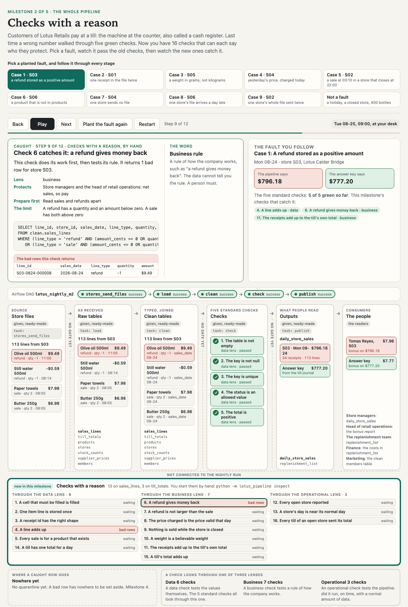

# Milestone 2: Checks with a reason

**Status:** Done. Design documents, lab notebooks, production code, tests, flow page and recap page are complete.

This folder is self-contained. Nothing in it imports from another milestone.



## Why this milestone exists

Milestone 1 found one wrong number by luck. A whole week has now passed: seven nights, 35 green checks, and **all six stores have a wrong number**. One manager would be overpaid on $1,520.68 of sales that never happened. Another would lose the bonus on a whole day, $587.42.

Lotus Retails is a chain of supermarkets. Customers pay at the tills. A **till** is the machine at the counter where a customer pays. It is also called a cash register.

**What you build:** sixteen checks, each with a reason. Thirteen for `sales_lines`, three for `till_totals`. You write each one by hand first, beside the common version that misses the fault. Every check says who it protects, what must be prepared first, and where exactly its limit is.

**The outcome:** every one of the nine planted sales faults is caught, on the right store and day. One check alone, the receipts against the till's own total, finds seven of them. And no check fires on the public holiday, the closed store, or the real sale of 400 bottles.

## The numbers

| Notebooks | Tests | Checks with a reason | Planted sales faults caught | False alarms | Gates | Rows set aside | New words |
|---|---|---|---|---|---|---|---|
| 8 | 148 | 16: 13 on `sales_lines`, 3 on `till_totals` | 9 of 9 | 0 | 0 | 0 | 18 |

Gates and rows set aside are still zero. The checks are run by hand. That is what is still wrong after milestone 3.

## Read it in this order

1. **[milestone_2_flow.html](milestone_2_flow.html)**: open it in a browser first. Pick a fault, and watch which check catches it.
2. [docs/BRD.md](docs/BRD.md): the six wrong numbers, and the rules of the business.
3. [docs/HLD.md](docs/HLD.md): a check taken apart, the three lenses, the four ways to prepare.
4. [docs/LLD.md](docs/LLD.md): every check, its limit and its SQL. Keep it open for the next two steps.
5. The notebooks in `notebooks/`, from `01` to `08`.
6. The code in `lotus_pipeline/` and `tests/`.
7. [checks/sales_lines.md](checks/sales_lines.md) and [checks/till_totals.md](checks/till_totals.md): the two check cards.
8. **[milestone_2_flow.html](milestone_2_flow.html)** again.
9. [milestone_2_recap.html](milestone_2_recap.html): a look back, and three questions.

## What is in this folder

| Folder or file | Holds |
|---|---|
| [docs/](docs/) | [BRD](docs/BRD.md), [HLD](docs/HLD.md) and [LLD](docs/LLD.md), each with diagrams |
| `notebooks/` | The lab: eight notebooks, run in order, plus `lab_helpers.py` |
| `lotus_pipeline/` | The pipeline, copied forward. New: `sales_checks.py`, `till_checks.py`, `inspect.py`, `reference/calendar.csv` |
| `checks/` | The check cards: `sales_lines.md`, now complete, and `till_totals.md` |
| `dags/` | The Airflow DAG: `lotus_nightly_m2`. The same five tasks as before |
| `tests/` | Tests for the production code |
| [milestone_2_flow.html](milestone_2_flow.html) | The whole pipeline at this milestone, animated, with real rows |
| [milestone_2_recap.html](milestone_2_recap.html) | The closing page |

## Set up

**Nothing new to install.** You need what milestone 1 set up: the project's `.venv`, and Docker. If you skipped milestone 1, follow [its set-up](../m1_green_checks_wrong_number/#set-up) first.

Start the warehouse, from the project folder. The command is the same on macOS, Linux and Windows:

```sh
docker compose up -d warehouse
```

**Prove it:** `docker compose ps` lists `lotus-warehouse` as `Up` and `(healthy)`.

This milestone does not need Airflow. Its notebooks run the pipeline as a plain program.

## Shut it down

From the project folder:

```sh
docker compose down
```

It stops the warehouse and keeps your data. How to delete the data and free the disk space is in [milestone 1's README](../m1_green_checks_wrong_number/#shut-it-down).

## The lab

Open the notebooks in VS Code, choose the project's `.venv` as the kernel, and run them in order. Each takes about ten minutes.

Every notebook loads the bonus week by itself if it is not there yet, so you can open any of them first.

| Notebook | What you do | New words |
|---|---|---|
| `01_empty_in_which_rows` | See a green not-null check hide an empty amount. Say in which rows an empty cell is wrong | Not-null check |
| `02_unique_on_which_columns` | Find a receipt and a whole file stored twice, behind a green unique check | Unique check, composite key |
| `03_a_believable_value` | Catch 1,180 kg of bananas without firing on a real sale of 400 bottles | Range check, format check |
| `04_rules_of_the_business` | Three rules the data cannot tell you. Each needs a join | Business rule, reference data, validity and accuracy |
| `05_across_two_tables` | Hold the receipts against the till's own total. Find the sales the join dropped | Reconciliation, control total, referential integrity, orphan row |
| `06_a_normal_day` | Work out what a normal Tuesday is for one store. Choose the limit from the data | Baseline, limit, anomaly |
| `07_the_false_alarm` | Watch a holiday set off six alarms. Fix it, and see what the fix costs | False positive, false negative, seasonality |
| `08_the_production_version` | The same logic as a tested program | |

The notebooks save `notebooks/results/answer_key_checks.json`. A test holds the production checks against it.

Faults that are not planted in the stores' files are planted in a private copy, the schema `lab`. The lab never changes the real tables.

## Run it from a terminal

From this folder. Load the bonus week once:

```sh
uv run python -m store_systems deliver --through 2026-08-30
uv run python -m lotus_pipeline run --day 2026-08-24    # then 08-25, and so on up to 08-30
```

Then look:

```sh
uv run python -m lotus_pipeline inspect                      # every check, and what it found
uv run python -m lotus_pipeline inspect --check till_total   # one check: its reason, and its bad rows
```

The first ends like this:

```
  Through the operational lens
    12. Every open store reported                      FAIL    1 bad rows   S04 08-25
    13. A store's day is near its normal day           FAIL    1 bad rows   S02 08-28
    16. Every till of an open store sent its total     pass

  10 of 16 checks found bad rows. Nothing was stopped:
  these checks are not part of the nightly run yet.
```

Read the last two lines again. The checks find everything, and the pipeline still publishes six wrong numbers.

## Run the tests

```sh
uv run pytest
```

About half a minute. Nothing needs to be running: the tests use DuckDB, their own files and their own database. When the warehouse is up, the week is tested a second time on Postgres.

**Every check has two kinds of test:** its fault is there and it returns exactly the bad rows, and the data is clean and it stays silent. "Clean" is four whole weeks.

## The pages show real numbers

No number on the flow page or the recap page is typed by hand. A script runs the real pipeline and the real checks for the whole bonus week, and writes what happened into the pages. A test fails when a page is out of date.

```sh
uv run python -m lotus_pipeline.flow_data
```

## Five things you learn

1. A check is only as good as the question behind it: unique on which columns, empty in which rows.
2. Most useful checks need the data prepared first: a join, a total, a comparison.
3. A valid value can still be wrong. Accuracy needs a second source.
4. A limit comes from the data, and a normal day depends on the weekday.
5. A check that cries wolf gets switched off. So prove it stays silent on what is not wrong.

## New words

| Word | Meaning |
|---|---|
| **Not-null check** | A check that a cell is filled. The skill is saying in which rows an empty cell is wrong |
| **Unique check** | A check that one thing is stored once |
| **Composite key** | A key made of more than one column, such as `receipt_id` + `line_no` |
| **Range check** | A check that a number is between a smallest and a largest believable value |
| **Format check** | A check that a text value has the right shape, such as a receipt id |
| **Business rule** | A rule of how the company works, such as "a refund gives money back". The data cannot tell you the rule. A person must |
| **Reference data** | A small list that people keep by hand, and that other data is judged against: prices, opening hours, holidays |
| **Validity and accuracy** | A valid value is allowed by the rules. An accurate value matches the real world. A value can be valid and wrong |
| **Reconciliation** | Comparing your numbers with another source that saw the same thing |
| **Control total** | A total counted a second way, kept only to be compared. The till's own total is one |
| **Referential integrity** | Every row that points to another table finds a row there |
| **Orphan row** | A row that points to something that does not exist, such as a sale for a product nobody typed |
| **Baseline** | The number you compare with. It is what normal looks like |
| **Limit** | The line between good and bad in a check. Also called a threshold |
| **Anomaly** | A value far from the baseline. It is a reason to look, not a proof of a fault |
| **False positive** | An alarm when nothing is wrong. Also called a false alarm |
| **False negative** | A fault with no alarm |
| **Seasonality** | A pattern that repeats with the calendar: Saturdays are busy, holidays are quiet |

Each word has an interview line in the project's [GLOSSARY.md](../../GLOSSARY.md).

## Test yourself

**1. A teammate says: we already have a unique check on `line_id`, and it passes every night. So no sale is counted twice. What do you show them?**

The check is on the wrong columns. `line_id` is new on every export, so a copy always gets a new one. Grouped by the true key, `receipt_id` + `line_no`, the week has 171 lines stored twice: `S01` on 08-25 and `S02` on 08-28. Unique on which columns is the whole question.

**2. Store `S04` sells butter at yesterday's price on Friday 08-28. The receipts add up to the tills' own total, to the cent. Is the day right?**

The table is right. The store is $6.00 short. The tills made the mistake themselves, so both counts agree. A second count only catches a fault that is born after the till. This one needs the price list: check 8, the price charged is the price valid that day.

**3. On Wednesday 08-26 every store sells less than half of a normal Wednesday. Your volume check stays silent. A colleague calls that a bug. Is it?**

No. Wednesday 08-26 is Founders' Day, and the calendar says so. Without the calendar the check would raise an alarm for every store, on a day when nothing is wrong. A check that cries wolf gets switched off. The price is honest too: a real fault on a holiday gets no alarm from this check.

## Still wrong

> One table is done well. There are five more, and they are nothing like it.

A price list has no till to be compared with. A list of people has no normal day. And these checks are still not part of the nightly run: tonight the pipeline would publish six wrong numbers again. Milestone 3 does the other tables. Milestone 4 lets a check stop a pipeline.
