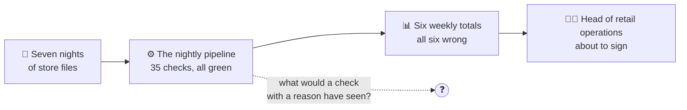

# BRD: Milestone 2, Checks with a reason

**Status:** Final; built
**Milestone:** 2 of 5 (see the project [README](../../../README.md#milestones))

> **What this document is.** A business requirements document (BRD) says what the business needs and why. It uses business words and no technology. Read it first. Next, read the [HLD](HLD.md) to see what is built.

## 1. The business problem

Lotus Retails is a fictional chain of supermarkets: six stores in three towns. Customers pay at the tills. A till is the machine at the counter where a customer pays. It is also called a cash register.

In milestone 1 one wrong number was found: store `S03` was $18.98 too high on Monday 2026-08-24, with five green checks. It was found by luck.

Now a whole week has passed. The pipeline has run seven nights. All 35 checks are green. And **all six stores have a wrong number**.

| Store | Manager | The report says | The receipts say | Wrong by |
|---|---|---|---|---|
| `S01` | Marta Lindqvist | $5,171.32 | $5,153.25 | +$18.07 |
| `S02` | Dana Okafor | $6,758.96 | $5,748.63 | +$1,010.33 |
| `S03` | Tomas Reyes | $5,106.60 | $5,087.62 | +$18.98 |
| `S04` | Ines Marchetti | $4,585.57 | $5,172.99 | −$587.42 |
| `S05` | Samir Haddad | $5,113.73 | $3,593.05 | +$1,520.68 |
| `S06` | Aiko Tanaka | $4,400.92 | $4,418.89 | −$17.97 |

Two managers would be paid too little. Four would be paid too much. One of them by more than a third of a week's sales.

## 2. The question to answer

The Monday question stays:

> Can I pay the bonus from last week's net sales, store by store? And if I cannot trust a number, which one, and why?

This milestone answers a smaller question first:

> For each wrong number: which check would have caught it, and who is that check for?

## 3. The people

| Who | What they need from this milestone |
|---|---|
| 🏬 Store managers | Pay from a number that someone has tested |
| 👩‍💼 Head of retail operations | A list: this store, this day, this row, this reason |
| 💰 Finance | To know when a store charged yesterday's price. The sales number is right, and money is still lost |
| 🚚 The replenishment team | To know when a store's day is missing or doubled, before they order from it |
| 🎓 Learner | To write a check that has a reason, and to see what the common version of it misses |

## 4. The rules of the business

A check cannot find these rules in the data. A person at Lotus must say them.

| Rule | Decided by |
|---|---|
| A refund gives money back. It makes net sales smaller | Finance |
| A refund is never larger than the sale it refunds | Finance |
| The price charged is the price in the price list on that day | The buying team |
| Nothing is sold while the store is closed | Store operations |
| Goods sold by weight: nobody carries more than 20 kg of one product to a till | Store operations |
| The receipts of a till add up to the till's own total, to the cent | Finance |
| Every open store sends its sales every night | Store operations |
| A public holiday and a planned closure are written in the calendar by head office | Head office |

The last rule matters as much as the others. Without the calendar, a quiet holiday looks like a fault.

## 5. What must not happen

Three things in the bonus week look wrong and are not. A check that fires on them is a false alarm, and a check that cries wolf gets switched off.

| What | When | Why it is right |
|---|---|---|
| Sales at about 40% of normal in every store | Wed 2026-08-26 | Founders' Day, a public holiday. The stores open from 10:00 to 16:00 |
| No file from `S01` | Thu 2026-08-27 | A planned refit. The store was closed |
| One line of 400 bottles of water | Sat 2026-08-29, `S02` | A café really bought them, for $236.00 |

## 6. What this milestone must deliver

1. A check for every ranked worry on the `sales_lines` check card.
2. For each check: who it protects, what must be prepared first, and the exact limit.
3. Each check written by hand first, beside the common version that misses the fault.
4. A proof for each: the fault is planted and the check returns it. The data is clean and the check is silent.
5. No alarm on the three things of section 5.
6. A check card for `till_totals`, the table the money check leans on.

## 7. Scope

**In scope:** checks for `sales_lines` and `till_totals`, run by hand.

**Out of scope for this milestone:**

| Not yet | Arrives in |
|---|---|
| Checks for products, stores, stock counts, supplier prices and members | Milestone 3 |
| The pipeline running the checks, and acting on a failure | Milestone 4 |
| Late files as a measured number, alerts, recovery | Milestone 5 |

Never in this project: machine-learned anomaly detection. This milestone uses a simple normal-day comparison, and says where that stops being enough.

## 8. Success criteria

- Every one of the nine planted sales faults is returned by at least one check, on the right store and day.
- The check for the tills' own total alone finds seven of the nine.
- The fault it cannot find, yesterday's butter price at `S04`, is found by another check: $6.00 on six lines.
- All checks return nothing on four clean weeks.
- No check returns the holiday, the closed store or the 400 bottles.

## 9. Assumptions

- The tills' own totals are right. They are counted inside the till and never pass through the program that writes the sales file.
- Four clean weeks are enough to say what a normal day is for each store and weekday.
- The calendar is kept by head office and is complete.
