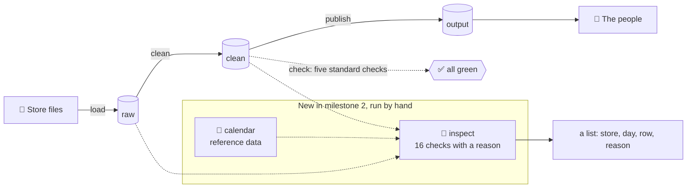
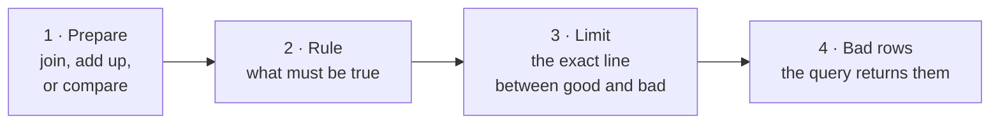
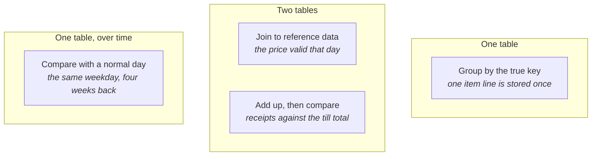

# HLD: Milestone 2, Checks with a reason

**Status:** Final; built
**Satisfies:** [BRD](BRD.md)

> **What this document is.** A high-level design (HLD) names the parts of the system, what each part does, and how data moves between them. It gives no exact columns or functions. Read it after the [BRD](BRD.md). The [LLD](LLD.md) then gives the exact detail.

## 1. Where the new part sits

The pipeline is the same as in milestone 1. The new checks stand **beside** it. A person runs them. The nightly run does not.

| Part | State |
|---|---|
| Load, clean, the five standard checks, publish, the DAG | Unchanged. Copied forward from milestone 1 |
| `clean.calendar` | **New.** Built by the clean step from one small file |
| Sixteen checks with a reason | **New.** Run with one command, `inspect` |
| Gates, quarantine, alerts | ❌ Not yet |

## 2. A check, taken apart

Every check has the same four parts. The first is the one most people skip.

| Part | Example: the receipts add up to the till's own total |
|---|---|
| Prepare | Add the sales lines up per till per day. Join that to `till_totals` |
| Rule | The two totals are the same money |
| Limit | Equal, to the cent |
| Bad rows | One row per till and day where they differ, with the difference |

A check also says who it protects. A check that cannot say that is deleted.

## 3. Three lenses

| Lens | It tests | Checks |
|---|---|---|
| **Data** | The values themselves: empty, twice, wrong shape, pointing at nothing | 6 |
| **Business** | A rule of how Lotus works: a refund gives money back | 7 |
| **Operational** | The pipeline: did every store report, with a normal amount of data | 3 |

The five standard checks all use the data lens. That is why they missed a refund with the wrong sign: only the business lens knows what a refund is.

## 4. Four ways to prepare

| Way | Used by | What it needs |
|---|---|---|
| Group by the true key | One item line is stored once | To know the grain: `receipt_id` + `line_no` |
| Join to reference data | Price of the day, opening hours, believable weight, every sale has a product | `products`, `stores`, the calendar |
| Add up, then compare | The till total, a refund not larger than its sale | A second source that saw the same thing |
| Compare with a normal day | A store's day is near its normal day, every open store reported | Four weeks of history, and the calendar |

## 5. The calendar

One small file, kept by hand: `lotus_pipeline/reference/calendar.csv`. Two rows.

| Day | Store | Kind | Hours |
|---|---|---|---|
| 2026-08-26 | All | Public holiday | 10:00 to 16:00 |
| 2026-08-27 | `S01` | Closed | |

It is **reference data**: a small list that people keep by hand, and that other data is judged against. It is not an eighth table from the stores. Head office types it.

Three checks read it. Without it, the holiday and the closed store are false alarms.

## 6. Key design decisions

| Decision | Reason |
|---|---|
| A check reads the whole table, not one night | A bad row stays bad until someone fixes it or sets it aside. Milestone 4 sets rows aside |
| The checks are not in the nightly run yet | First prove each check, on its fault and on clean data. Then let it stop a pipeline |
| The true key is `receipt_id` + `line_no` | `line_id` is new on every export, so it can never find a row sent twice |
| The till total must be equal to the cent | Both sides are whole cents. Any room would hide a small fault |
| The normal day is the same weekday in the four weeks before | A Saturday is nothing like a Tuesday. One number for every day would fail every weekday |
| The volume limit is 60% to 140% | In the clean weeks a store's day stays between 74% and 131% of normal. The limit leaves room on both sides |
| Days in the calendar are left out of the volume check | A holiday is not a normal day. The cost is stated: a fault on a holiday is not caught by this check |
| A fixed limit for weight, 20 kg | It is a fact about people and tills, not about the data. No history is needed |
| `till_totals` gets three checks of its own | Every money check leans on it. A control you cannot trust is worse than none |

### A fixed limit, or a normal-day limit?

| | Fixed limit | Normal-day limit |
|---|---|---|
| Example | A weight is not above 20 kg | A store's lines are 60% to 140% of normal |
| It needs | A fact from the business | History |
| It breaks when | The fact changes | The world changes: a new store, a holiday, a slow season |
| False alarms | Almost none | Some. The limit decides how many |

## 7. What this design cannot do

| Limit of the design | What happens | Where it is handled |
|---|---|---|
| The normal day is an average of four days | A slow drift over months, or a holiday that moves each year, is not understood | Named in notebook 7. Real teams use more history, or a model |
| A new store has no history | The volume check says nothing for its first three weeks | Stated in the check's limit |
| The till total cannot see a fault made in the till | Yesterday's price is in both counts | The price check finds it |
| A failed check changes nothing | The pipeline still publishes six wrong numbers | Milestone 4 |

## 8. Technology

The same as milestone 1: Python 3.12, Postgres 16 and Apache Airflow 3.4 in Docker, DuckDB for the tests. Nothing new is installed.

## 9. Risks

| Risk | Handling |
|---|---|
| A check fires on good data | Every check is tested on four clean weeks, and on the holiday, the closed store and the 400 bottles |
| A check is written for a fault it cannot see | Every check is tested on its planted fault, and must return exactly those rows |
| The SQL works on one database only | The whole week is tested on DuckDB and on Postgres |
