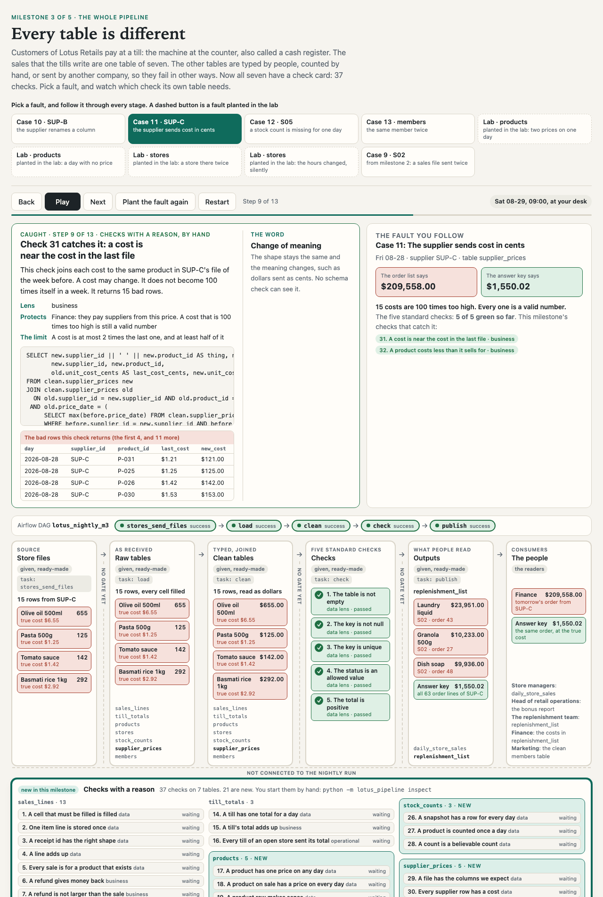

# Milestone 3: Every table is different

**Status:** Done. Design documents, lab notebooks, production code, tests, flow page and recap page are complete.

This folder is self-contained. Nothing in it imports from another milestone.



## Why this milestone exists

Milestone 2 checked the sales. That protects the store managers' pay. Three other groups at Lotus Retails read other tables, and in the bonus week each of them was hurt.

| Who | What happened | The cost |
|---|---|---|
| The replenishment team | Nobody counted the milk at one store. The gap was read as an empty shelf | 18 bottles ordered where 15 were needed |
| Finance | A supplier renamed a column in its price file | Twelve products with no cost on the order list |
| Finance | Another supplier sent its costs in cents | An order list of $209,558.00 where $1,550.02 is right |
| Marketing | One customer signed up twice | Two emails to one person |

No check from milestone 2 can help. A price list has no till to be compared with. A till is the machine at the counter where a customer pays, also called a cash register. A list of people has no normal day.

**What you build:** a check card for each of the five other tables, and 21 checks from those cards. A written contract for the suppliers' file. And the seven cards side by side, to see which checks belong on every table and which on only one.

**The outcome:** all seven tables have a card, and 37 checks cover them. All thirteen planted faults are caught. The contract refuses 2 of the suppliers' 15 files at the door. No check on the members table ever shows a name or an email.

## The numbers

| Notebooks | Tests | Checks with a reason | Tables with a check card | Planted faults caught | Supplier files refused | Gates | Rows set aside | New words |
|---|---|---|---|---|---|---|---|---|
| 8 | 248 | 37 on 7 tables. 21 are new | 7 of 7 | 13 of 13 | 2 of 15 | 0 | 0 | 9 |

Gates and rows set aside are still zero. That is the last line of this page.

## Read it in this order

1. **[The flow page](https://vijaysngrajput.github.io/quality-gates-on-a-running-pipeline/src/m3_every_table_is_different/milestone_3_flow.html)**: open it first. Pick a fault in a table that is not about money.
2. [docs/BRD.md](docs/BRD.md): who was hurt, and how each table is made.
3. [docs/HLD.md](docs/HLD.md): what each table needs, and why it is not what sales needed.
4. [docs/LLD.md](docs/LLD.md): every check, its limit and its SQL. Keep it open for the next two steps.
5. The notebooks in `notebooks/`, from `01` to `08`.
6. The code in `lotus_pipeline/` and `tests/`, and the contract in [contracts/supplier_prices.yml](contracts/supplier_prices.yml).
7. The seven check cards in [checks/](checks/).
8. The flow page again.
9. **[The recap page](https://vijaysngrajput.github.io/quality-gates-on-a-running-pipeline/src/m3_every_table_is_different/milestone_3_recap.html)**: a look back, and three questions.

In your own copy of the project, the two pages are `milestone_3_flow.html` and `milestone_3_recap.html` in this folder. Open them in a browser.

## What is in this folder

| Folder or file | Holds |
|---|---|
| [docs/](docs/) | [BRD](docs/BRD.md), [HLD](docs/HLD.md) and [LLD](docs/LLD.md), each with diagrams |
| `notebooks/` | The lab: eight notebooks, run in order, plus `lab_helpers.py` |
| `lotus_pipeline/` | The pipeline, copied forward. New: `other_checks.py`, `contract.py`. Changed: `inspect.py`, `load.py` |
| `contracts/` | The data contract for the suppliers' file, written by hand |
| `checks/` | Seven check cards, one per table |
| `dags/` | The Airflow DAG: `lotus_nightly_m3`. The same five tasks as before |
| `tests/` | Tests for the production code |
| `milestone_3_flow.html`, `milestone_3_recap.html` | The two animated pages |

## Set up

One small library is new: PyYAML, to read the contract. From the project folder, on macOS, Linux and Windows alike:

```sh
uv sync
docker compose up -d warehouse
```

**Prove it:** `uv run python -c "import yaml; print(yaml.__version__)"` prints a version number, and `docker compose ps` lists `lotus-warehouse` as `Up` and `(healthy)`.

This milestone does not need Airflow. If you skipped milestone 1, follow [its set-up](../m1_green_checks_wrong_number/#set-up) first.

## Shut it down

From the project folder:

```sh
docker compose down
```

It stops the warehouse and keeps your data. How to delete the data and free the disk space is in [milestone 1's README](../m1_green_checks_wrong_number/#shut-it-down).

## The lab

Open the notebooks in VS Code, choose the project's `.venv` as the kernel, and run them in order. Each takes about ten minutes. Every notebook loads the bonus week by itself if it is not there yet.

| Notebook | What you do | New words |
|---|---|---|
| `01_a_price_has_a_start_and_an_end` | Check a price list against itself: two prices on one day, and a day with none | Validity dates |
| `02_six_rows_wrong_everywhere` | See a row count, useless on sales, become the best check there is | |
| `03_a_gap_is_not_a_zero` | Find a row that is not there, by first building the rows you expected | Snapshot table |
| `04_the_same_person_twice` | Find one person with two member numbers. Keep her name out of the check's output | Duplicate, personal data |
| `05_a_file_you_do_not_control` | A supplier renames a column. See why the loaded table cannot tell you | Schema, schema drift, breaking change |
| `06_same_shape_new_meaning` | A supplier sends cents. Every column is there and every value is valid | Change of meaning |
| `07_a_contract_for_the_supplier` | Read a contract part by part, and refuse two files at the door | Data contract |
| `08_cards_side_by_side` | Compare the seven cards. Then the same logic as a tested program | |

Faults that are not planted in the stores' files are planted in a private copy, the schema `lab`. The lab never changes the real tables.

## Run it from a terminal

From this folder. Load the bonus week once:

```sh
uv run python -m store_systems deliver --through 2026-08-30
uv run python -m lotus_pipeline run --day 2026-08-24    # then 08-25, and so on up to 08-30
```

Then look:

```sh
uv run python -m lotus_pipeline inspect                  # 37 checks on 7 tables
uv run python -m lotus_pipeline inspect --side-by-side   # the seven cards, compared
uv run python -m lotus_pipeline contract                 # the suppliers' files against the contract
```

The contract command ends like this:

```
  supplier_prices_SUP-C_2026-08-28.csv       refuse
      value     unit_cost: 0 decimals, not 2: dollars are written like 2.10 in 15 rows, like 655 on line 2

  15 files. 2 would be refused at the door.
```

"Would be" is the important word. The file is still loaded. Nothing acts on a check yet.

## Run the tests

```sh
uv run pytest
```

Under a minute. Nothing needs to be running: the tests use DuckDB, their own files and their own database. When the warehouse is up, the week is tested a second time on Postgres.

**Every check has two kinds of test:** its fault is there and it returns exactly the bad rows, and the data is clean and it stays silent. One more test runs every check on the members table and fails if a name, an email or a phone number is in the result.

## The pages show real numbers

No number on the flow page or the recap page is typed by hand. A script runs the real pipeline and the real checks, and writes what happened into the pages. A test fails when a page is out of date.

```sh
uv run python -m lotus_pipeline.flow_data
```

## Five things you learn

1. How a table is made decides how it fails. So every table needs its own card.
2. The same check is useless on one table and exact on another: a row count, on six stores.
3. To find a row that is missing, first build the rows you expected.
4. A perfect shape can carry a wrong meaning. Compare with the last file, and with another table.
5. A contract speaks at the door. A check speaks after the load. You want both.

## New words

| Word | Meaning |
|---|---|
| **Validity dates** | The first and the last day a row is true, such as the days a price applies |
| **Snapshot table** | A table that holds the state of something on each day, such as a stock count. A missing day is a gap, not a zero |
| **Duplicate** | One real thing stored more than once under different keys, such as one person with two member ids |
| **Personal data** | Data about a person: a name, an email, a phone number. It must not travel into logs and check results |
| **Schema** | The shape of a table or a file: the column names, the type of each column, and the rules for the values |
| **Schema drift** | A schema that changes without anyone agreeing: a column renamed, added or removed |
| **Breaking change** | A change that removes or changes something a reader uses, so old readers fail. Its opposite is an additive change, which only adds |
| **Change of meaning** | The shape stays the same and the meaning changes, such as dollars sent as cents. No schema check can see it |
| **Data contract** | A written agreement between the producer of data and its consumers: an owner, the columns, the rules for the values, and a change policy |

Each word has an interview line in the project's [GLOSSARY.md](../../GLOSSARY.md).

A **schema registry** is named and not built. It is a service that stores the agreed schema of every file and refuses a breaking change by itself. Here you write the contract by hand, so you see what one holds.

## Test yourself

**1. A teammate copies the checks of `sales_lines` onto the stores table: not empty, key not null, key unique. All pass. Is the stores table safe?**

No. In the lab, a table with six rows and five stores passed a row count: one store was there twice and another was gone. For a table this small the exact count and the exact list are facts you can know, so check those. And check that it is the same as yesterday: this table should stand still.

**2. On Friday 08-28 the file of `SUP-C` has every column, no empty cell, and only valid numbers. The schema check is green and the not-null check is green. Finance says tomorrow's order looks strange. Where do you look?**

At the meaning, not the shape. The order list says $209,558.00, and $1,550.02 is right: the supplier sent cents where dollars were agreed. A value can only be judged beside something else, so compare each cost with the supplier's last file and with the shelf price. Checks 31 and 32 do that, and the contract would refuse the file at the door.

**3. The order list says: order 18 bottles of milk for `S05`. Every stock count in the table is a believable number. Which check could still be wrong for this table?**

The one that looks for rows that are not there. Nobody counted the milk, and the gap is read as zero stock. The right order is 15. A check on values cannot see a missing row. You must first build the rows you expected: every open store, every product on sale, every day.

## Still wrong

> The checks exist in notebooks. The pipeline does not run them, and a failure changes nothing.

Thirty-seven checks, each with a reason and a proof. And tonight the pipeline will run its five standard checks, turn green, and publish six wrong store totals, an order list of $209,558.00, and a member list with one person twice. Milestone 4 puts the checks in the pipeline, as gates.
