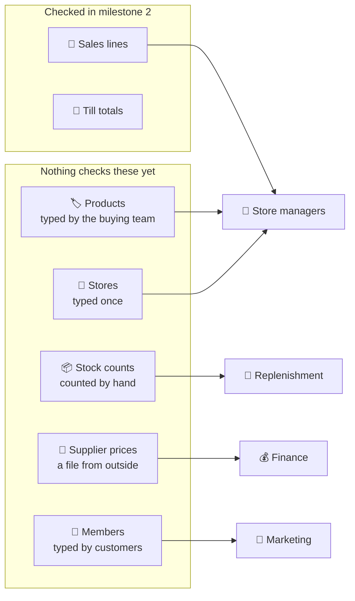

# BRD: Milestone 3, Every table is different

**Status:** Final; built
**Milestone:** 3 of 5 (see the project [README](../../../README.md#milestones))

> **What this document is.** A business requirements document (BRD) says what the business needs and why. It uses business words and no technology. Read it first. Next, read the [HLD](HLD.md) to see what is built.

## 1. The business problem

Lotus Retails is a fictional chain of supermarkets: six stores in three towns. Customers pay at the tills. A till is the machine at the counter where a customer pays. It is also called a cash register.

Milestone 2 checked the sales, and the tills' own totals. That protects the store managers' pay.

Three other groups at Lotus read other tables. Nothing protects them yet. In the bonus week, each of them was hurt, and no check said so.

| Who | What happened | When | The cost |
|---|---|---|---|
| 🚚 The replenishment team | Nobody counted the milk at store `S05`. The pipeline read the gap as an empty shelf | Fri 2026-08-28 | 18 bottles ordered where 15 were needed |
| 💰 Finance | Supplier `SUP-B` renamed a column in its price file. Twelve products lost their cost | Tue 2026-08-25 | An order list that cannot be approved or paid |
| 💰 Finance | Supplier `SUP-C` sent its costs in cents | Fri 2026-08-28 | Fifteen costs 100 times too high. Olive oil at $655.00, not $6.55 |
| 📣 Marketing | One customer signed up twice, with capital letters in her email the second time | Wed 2026-08-26 | Two emails to one person, and her points split over two accounts |

## 2. The question to answer

The Monday question stays:

> Can I pay the bonus from last week's net sales, store by store? And if I cannot trust a number, which one, and why?

This milestone asks it for everyone else:

> What does each of the other five tables need? And why is it not what the sales needed?

## 3. Five tables, made in five ways

How a table is made decides how it fails.

| Table | Made by | So it fails like this |
|---|---|---|
| Products | A person in the buying team, typing | A price that is not closed. A day with no price. A slip of the finger |
| Stores | Head office, once | Almost never. So any change is either news or a mistake |
| Stock counts | A person walking the store before closing | A shelf that is skipped |
| Supplier prices | Another company's program | A column renamed. A number in another unit. Lotus is not told |
| Members | Customers, on a phone, standing in a shop | The same person twice. A mistyped email |

A check that works for one of these is useless for another. A sales table can be held against a till. A price list has no till. A list of people has no normal day.

## 4. The rules of the business

| Rule | Decided by |
|---|---|
| A product has exactly one price on any day it is on sale | The buying team |
| A new price is at most twice the old one, and at least half. Outside that, a person confirms | The buying team |
| Lotus has six stores | Head office |
| Every product on sale is counted in every open store, every day | Store operations |
| A supplier's cost is in US dollars, with two decimals | The contract with the suppliers |
| A product costs Lotus less than it sells for | Finance |
| One person is one member | Marketing |
| A phone number is optional. The answer to "may we email you?" is not | Marketing, and the law |

## 5. People are not rows

The members table is about people. A name, an email and a phone number are **personal data**.

A check prints the rows it finds. Those lines go into logs, into reports, and later into a table of rows set aside. If a check prints an email, the email travels to places where nobody is watching it.

**Requirement:** no check on the members table may show a name, an email or a phone number. A bad row is named by its member number.

## 6. A file Lotus does not control

The suppliers' file is the only data that comes from outside Lotus. Lotus cannot fix the program that writes it. Lotus can only **agree** with the supplier what the file must look like, and refuse a file that breaks the agreement.

**Requirement:** a written agreement for the suppliers' file. It names an owner on both sides, every column and its type, the rule for each value, and what kind of change needs notice.

## 7. What this milestone must deliver

1. A check card for each of the five tables, so all seven tables have one.
2. Checks for each table, each with a reason, written by hand first.
3. The four faults of section 1, each caught by at least one check.
4. No name, email or phone number in any check result.
5. A written agreement for the suppliers' file, and a way to hold a file against it.
6. The seven cards side by side: which checks are on every card, which on only one, and why.

## 8. Scope

**Out of scope for this milestone:**

| Not yet | Arrives in |
|---|---|
| The pipeline running any of these checks, or acting on a failure | Milestone 4 |
| Refusing a supplier's file automatically | Milestone 4 |
| Alerts, run history, recovery | Milestone 5 |

Never in this project: a schema registry. It is a service that stores the agreed shape of every file and refuses a breaking change by itself. This milestone writes the agreement by hand, and names the tool.

## 9. Success criteria

- All seven tables have a check card.
- The missing count, the renamed column, the cents and the double member are each returned by a check, and by nothing in the five standard checks.
- Two of the suppliers' fifteen files are refused by the written agreement, with the reason.
- Every check returns nothing on four clean weeks.
- No check on members returns personal data. A test proves it.

## 10. Assumptions

- The price list, the stores table and the tills' totals are right in all five weeks. Their faults are planted in tests, on a private copy.
- A supplier's real cost changes by a few cents at a time. Three such changes are in the data, and no check may return them.
