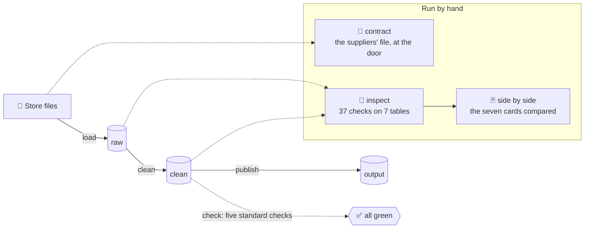
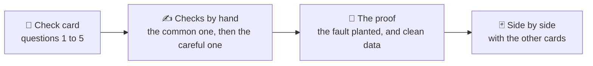
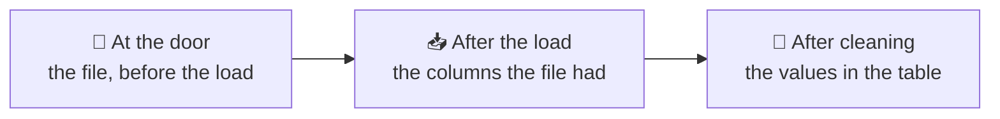

# HLD: Milestone 3, Every table is different

**Status:** Final; built
**Satisfies:** [BRD](BRD.md)

> **What this document is.** A high-level design (HLD) names the parts of the system, what each part does, and how data moves between them. It gives no exact columns or functions. Read it after the [BRD](BRD.md). The [LLD](LLD.md) then gives the exact detail.

## 1. Where the new part sits

The pipeline is unchanged. The checks still stand beside it, run by hand. Two things are new: the checks now cover all seven tables, and one check stands **at the door**, before the load.

| Part | State |
|---|---|
| Load, clean, the five standard checks, publish, the DAG | Unchanged, with one addition to the load step |
| `raw.file_columns` | **New.** The load step keeps the first line of every file |
| 21 checks for five tables | **New.** With milestone 2's sixteen: 37 checks on 7 tables |
| A data contract for the suppliers' file | **New.** One page, and a command that holds a file against it |
| The cards side by side | **New** |
| Gates, quarantine, alerts | ❌ Not yet |

## 2. The method, five more times

The same three steps for every table. The card comes first.

## 3. What each table needs, and why

| Table | How it is made | What that makes it need | It does not need |
|---|---|---|---|
| `products` | Typed. A price has a start and an end | Each row tested against its **neighbouring** rows: no two prices on one day, no day without one | A normal day. A till |
| `stores` | Typed once, six rows | An **exact count**, and a comparison with **yesterday's file** | A range, a limit, a baseline |
| `stock_counts` | Counted every day, by hand | The list of rows that **should** be there, to find the one that is not | A second count. There is none |
| `supplier_prices` | A file from another company | A look at the file's **own columns**, and a comparison with the **last file** | Trust |
| `members` | Typed by customers | The value **cleaned** before it is compared. And care with what a check prints | A sum. Nothing here adds up |

## 4. Four new ways to prepare

Milestone 2 had four: group by the true key, join to reference data, add up and compare, compare with a normal day. These tables need four more.

| Way | Used by | Why sales never needed it |
|---|---|---|
| **Row against neighbouring row** | One price at a time, no gap between prices, a new price near the old one | A sale does not depend on the sale before it |
| **Build the rows you expected** | A count for every day | A sale that did not happen is not missing |
| **This file against the last file** | The stores table did not change, a cost near the last cost | A day of sales is new every day |
| **Clean, then compare** | One person once | A till does not type |

## 5. Three places a fault can be caught

| Place | What can be seen there | Example |
|---|---|---|
| At the door | The file's columns, and each value against the agreed rule | The contract refuses a file with a missing column, or with cents |
| After the load | Which columns each file really had | Check 29: `unit_cost` is missing from one file |
| After cleaning | The values, and how they compare with other rows and tables | Checks 31 and 32: a cost 100 times the last one, and above the shelf price |

The later a fault is caught, the more it has already touched. Milestone 4 turns these three places into gates.

## 6. Same shape, new meaning

The two supplier faults look alike and are opposites.

| | A renamed column | Cents for dollars |
|---|---|---|
| The shape of the file | Changed | The same |
| The meaning of a value | The same | Changed |
| A check on the columns | Catches it | Sees nothing |
| A not-null check | Catches it, after the load | Sees nothing |
| What catches it | The schema | Another number to compare with: the last file, the shelf price, or the agreed range |

A change of shape is loud once you look at the shape. A change of meaning is silent for ever, unless the value is compared with something.

## 7. Key design decisions

| Decision | Reason |
|---|---|
| Every table gets its own card before any check | The checks of `sales_lines` would be wrong here. A copied check has no reason |
| The load step keeps every file's first line | A loaded table cannot say which columns the file had. A column the loader did not expect is simply not there |
| A missing column is breaking, a new column is additive | A missing column breaks a reader. A new one does not. The first must stop a file, the second must only be reported |
| The expected number of stores is written down: six | For a table this small, the exact count is a fact from the business, not from the data |
| A new price or cost may be at most twice, and at least half, the old one | Wide enough for any real change in the data. Narrow enough for a slip of the finger or a change of unit |
| The cents are caught three ways | Against the last file, against the shelf price, and by the contract's rule. Each can fail alone: a first file has no last file |
| No check on `members` returns personal data | A check's output is printed, logged and copied |
| The contract is one hand-written YAML page | The reader should see what a contract holds. A registry would hide it |
| The checks are still not in the nightly run | That is milestone 4. First every table gets a reason |

### A check, or a contract?

| | A check on a table | A contract |
|---|---|---|
| When it speaks | After the load | At the door, before the load |
| Who wrote the rule | The team that reads the data | Both sides, together |
| It can stop | What happens next | The file itself |
| What it cannot see | The file's own columns | How a value compares with other tables |

You want both.

## 8. What this design costs

| Cost | What happens | Fixed in |
|---|---|---|
| 37 checks, and none in the nightly run | The pipeline still publishes six wrong store totals, an order list with no costs, and a member list with one person twice | Milestone 4 |
| The contract is checked by hand | A refused file is still loaded | Milestone 4 |
| A fixed "twice or half" limit | A product whose price really triples needs a person to say yes | Stated on the card |

## 9. Technology

One small library is new: PyYAML, to read the contract. `uv sync` installs it into the project's `.venv`. Nothing else changes.

## 10. Risks

| Risk | Handling |
|---|---|
| A check copied from another table with no reason | Every check names who it protects. The side-by-side view shows which family is on which card |
| A check prints personal data | A test runs every member check on bad rows and looks for a name, an email or a phone in the result |
| The contract and the loader disagree about the columns | A test compares the contract's columns with the loader's |
