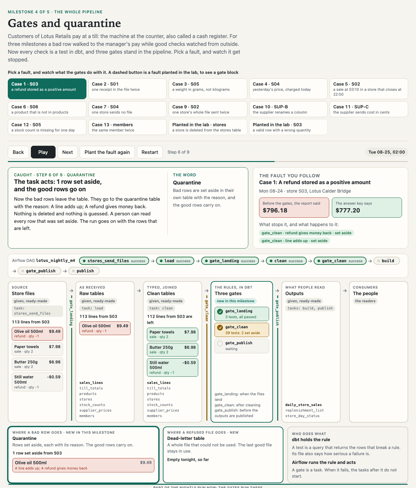

# Milestone 4: Gates and quarantine

**Status:** Done. Design documents, lab notebooks, production code, tests, flow page and recap page are complete.

This folder is self-contained. Nothing in it imports from another milestone.



## Why this milestone exists

After three milestones Lotus Retails has 37 checks, each with a reason. A person can run them and see every bad row.

And every night at 02:00 the pipeline runs its own five checks, turns green, and publishes six wrong store totals, an order list of $209,558.00 where $1,550.02 is right, and a member list with one person twice. **The checks know. The pipeline does not ask them.**

**What you build:** you move every check into dbt as a test, and write beside each one what a failure does. Then you put three gates into the nightly run: when the files land, after cleaning, and before the outputs are published. A failed check now stops the run, sets the bad rows aside, or warns.

**The outcome:** on Monday morning the report answers both sentences of the question, by itself.

```
  Store                           Manager              Net sales  Bonus (1%)   Pay?
  S01  Lotus Ashby High Street    Marta Lindqvist      $5,153.25      $51.53   yes
  S02  Lotus Ashby Market Square  Dana Okafor          $5,724.68           -   DO NOT PAY YET
         Sun 08-30: 4 rows set aside ($23.95): Nothing is sold while the store is closed
  S03  Lotus Calder Bridge        Tomas Reyes          $5,097.11           -   DO NOT PAY YET
         Mon 08-24: 1 row set aside ($9.49): A line adds up; A refund gives money back
  S04  Lotus Calder Station       Ines Marchetti       $4,585.57           -   DO NOT PAY YET
         Tue 08-25: no sales file arrived. The tills counted $587.42
  ...
  1 of 6 stores can be paid.
```

A till is the machine at the counter where a customer pays. It is also called a cash register.

## The numbers

| Notebooks | Tests | dbt tests | Gates | Airflow tasks | Rows set aside after Sunday | Files refused | Planted faults handled | New words |
|---|---|---|---|---|---|---|---|---|
| 8 | 103 | 46, and 2 unit tests | 3 | 8 | 181 | 2 | 13 of 13 | 14 |

For the first time, gates and rows set aside are not zero.

## Who does what

Beginners mix the two tools up. This project keeps them apart, on every page.

| | dbt | Airflow |
|---|---|---|
| Its job | **It holds the rule.** "The receipts must equal the till total" is a dbt test: a query that returns the rows that break the rule | **It runs the rule and acts on the result.** When the check runs, what waits for it, what happens when it fails |

## Read it in this order

1. **[The flow page](https://vijaysngrajput.github.io/quality-gates-on-a-running-pipeline/src/m4_gates_and_quarantine/milestone_4_flow.html)**: open it first. Pick a fault and watch it stop at a gate.
2. [docs/BRD.md](docs/BRD.md): stop, set aside, or warn, and who decided.
3. [docs/HLD.md](docs/HLD.md): the three gates, who does what, and write, audit, publish.
4. [docs/LLD.md](docs/LLD.md): every test at every gate, and the tables a gate writes. Keep it open for the next two steps.
5. The notebooks in `notebooks/`, from `01` to `08`.
6. The dbt project in `dbt_project/`, the code in `lotus_pipeline/`, the DAG in `dags/`, and `tests/`.
7. The seven check cards in [checks/](checks/). Question 7 is now answered on each.
8. The flow page again.
9. **[The recap page](https://vijaysngrajput.github.io/quality-gates-on-a-running-pipeline/src/m4_gates_and_quarantine/milestone_4_recap.html)**: a look back, and three questions.

In your own copy of the project, the two pages are `milestone_4_flow.html` and `milestone_4_recap.html` in this folder. Open them in a browser.

## What is in this folder

| Folder or file | Holds |
|---|---|
| [docs/](docs/) | [BRD](docs/BRD.md), [HLD](docs/HLD.md) and [LLD](docs/LLD.md), each with diagrams |
| `notebooks/` | The lab: eight notebooks, run in order, plus `lab_helpers.py` |
| `dbt_project/` | **New.** Every rule as a dbt test: `tests/landing/`, `tests/clean/`, `tests/publish/`. And the prepared models, with unit tests |
| `lotus_pipeline/` | New: `gates.py`, `dbt_runner.py`. Changed: `publish.py`, `report.py`, `clean.py`, `pipeline.py` |
| `dags/` | `lotus_nightly_m4`, with eight tasks. And a lab DAG with Airflow's own SQL check operator |
| `checks/`, `contracts/` | The seven check cards, and the suppliers' contract |
| `tests/` | Tests for the production code and for the dbt project |
| `milestone_4_flow.html`, `milestone_4_recap.html` | The two animated pages |

## Set up

Two things are new: dbt, and a rebuilt Airflow image with dbt inside. The commands are the same on macOS, Linux and Windows. From the project folder:

```sh
uv sync                        # installs dbt into the project's .venv. Nothing outside the project
docker compose up -d --build   # rebuilds the Airflow image once. Two to five minutes
```

**Prove it:**

```sh
uv run dbt --version                                         # prints dbt's version, and "postgres" and "duckdb"
docker compose exec airflow /opt/lotus-venv/bin/dbt --version   # the same, inside the container
docker compose ps                                            # both containers are Up
```

Then open http://localhost:8080 . You see one more DAG: `lotus_nightly_m4`.

If the build stops halfway, or a port is taken, see ["If something goes wrong" in milestone 1](../m1_green_checks_wrong_number/#if-something-goes-wrong). The fixes are the same.

## Shut it down

From the project folder:

```sh
docker compose down
```

It stops both containers and keeps your data. How to delete the data and free the disk space is in [milestone 1's README](../m1_green_checks_wrong_number/#shut-it-down). The rebuilt image has the same name, so the same commands remove it.

## The lab

Open the notebooks in VS Code, choose the project's `.venv` as the kernel, and run them in order. Each takes about ten minutes. Notebooks 5, 7 and 8 drive the real Airflow, so they need both containers.

| Notebook | What you do | New words |
|---|---|---|
| `01_a_rule_lives_in_dbt` | Move a check you wrote by hand into dbt. Run dbt for the first time | Generic test, singular test |
| `02_how_serious_is_it` | Give a test a level of seriousness. Find the rows it kept | Severity, stored failures |
| `03_test_the_sql_not_the_data` | Prove your own SQL on six rows typed by hand | Unit test |
| `04_a_gate_and_where_it_stands` | Run one rule in three places, and see what each can see | Gate, gate placement |
| `05_warn_block_or_set_aside` | Decide what a failure does. Block a real Airflow run, and see the old numbers stay | Warn or block; write, audit, publish; upstream failure |
| `06_quarantine` | Set bad rows aside with a reason. Refuse a whole file. Make the output say what it is missing | Quarantine, rejected rows, dead-letter table, partial load |
| `07_test_the_tests` | Plant each fault and watch its gate catch it. One check written three ways | |
| `08_the_production_version` | The whole bonus week, under Airflow | |

Whatever a notebook plants, it puts back before it ends.

## Run it from a terminal

From this folder. Each line is one step, and Airflow starts exactly these.

```sh
uv run python -m store_systems deliver --through 2026-08-24
uv run python -m lotus_pipeline run --day 2026-08-24          # all eight steps
```

```
load:         622 new files, 37,710 rows copied to the raw tables.
gate landing: 3 tests, 3 passed.
clean:        7 clean tables rebuilt. sales_lines has 20,482 rows.
gate clean: 39 tests, 37 passed.
    set aside       1  A line adds up
    set aside       1  A refund gives money back
    rows set aside: 1 in sales_lines
build:        staging.daily_store_sales has 174 rows. Nobody reads staging.
gate publish: 5 tests, 4 passed.
    warning         1  Every open store has a day we can pay from
publish:      daily_store_sales has 174 rows. replenishment_list has 234 rows for tomorrow. 1 store days are not ready to pay.
```

One gate alone, and dbt itself:

```sh
uv run python -m lotus_pipeline gate-clean --day 2026-08-24
uv run python -m lotus_pipeline dbt test --select test_type:unit   # any dbt command, on this project
```

One thing to know before you run `dbt test` by hand: after a full night the bad rows are already set aside, so most tests pass. Run `clean` first to see them fail: `uv run python -m lotus_pipeline clean --day 2026-08-24`. And run the night again afterwards.

These commands use the warehouse in Docker. To use a database in one file, with nothing running, set `LOTUS_WAREHOUSE=duckdb` first.

Under Airflow, start a night on the DAG's page, or:

```sh
docker compose exec airflow airflow dags trigger lotus_nightly_m4 --logical-date 2026-08-24T07:00:00+00:00
```

## Run the tests

```sh
uv run pytest
```

About two minutes: the tests run dbt for every night of the week, on two databases. Nothing needs to be running. The tests use DuckDB, their own files and their own database. When the warehouse is up, the week is tested a second time on Postgres.

**Test the tests.** Every planted fault must be caught by its gate, and the right thing must happen to it. Four clean weeks must pass every gate. And a blocked run must leave the published table exactly as it was.

## The pages show real numbers

No number on the flow page or the recap page is typed by hand. A script runs the real pipeline, with its gates, and writes what happened into the pages. A test fails when a page is out of date.

```sh
uv run python -m lotus_pipeline.flow_data
```

## Five things you learn

1. dbt holds the rule. Airflow runs it and acts on the result.
2. A failed check must do something: stop the run, set the rows aside, or warn. Choose for each check.
3. Where a gate stands decides what it can protect.
4. Set bad rows aside with a reason, let the good rows go on, and make the output say what it is missing.
5. Test the tests: plant the fault, and watch its gate catch it.

## New words

| Word | Meaning |
|---|---|
| **Generic test** | A dbt test that is ready-made and switched on with one line, such as `not_null` or `unique` |
| **Singular test** | A dbt test that is one query in one file, written for one rule |
| **Severity** | How serious a failed test is for dbt: `error` stops the gate, `warn` lets the run go on |
| **Stored failures** | The rows a test returned, kept by dbt in a table named after the test |
| **Unit test** | A test of your SQL on a few rows typed by hand, with the answer typed beside them. A data test checks tonight's data |
| **Gate** | A step in the pipeline that runs checks and decides whether the data may go on |
| **Gate placement** | Where a gate stands: when the files land, after cleaning, or before publish. The same check protects different things in each place |
| **Warn or block** | The choice for a failed check: let the run go on and record it, or stop the run |
| **Write, audit, publish** | Build the output in a side table, check it there, and only then show it to its readers |
| **Upstream failure** | A task that failed earlier in the DAG. Airflow does not start the tasks after it, and marks them `upstream_failed` |
| **Quarantine** | Bad rows are set aside in their own table with the reason, and the good rows carry on |
| **Rejected rows** | The rows a check refused. Also called rejects |
| **Dead-letter table** | A table for things that could not be processed at all, such as a whole file that was refused |
| **Partial load** | A load where the good rows went on and the bad ones did not. The output must say what it is missing |

Each word has an interview line in the project's [GLOSSARY.md](../../GLOSSARY.md).

**Shown, not installed:** Great Expectations and Soda. One check is written three ways in the [LLD](docs/LLD.md#10-one-check-three-ways-and-a-fourth) and in notebook 7. The tool changes. The reasoning does not.

## Test yourself

**1. On Monday 08-24 `gate_clean` sets one refund row aside at `S03`. The report now says $786.69 for the store. Is that the right number, and can the manager be paid from it?**

No, twice. The receipts say $777.20. Setting a row aside does not repair it: the refund is not added any more, and it is not taken away either. The pipeline never guesses. So the output says what it is missing: one row set aside, $9.49, and "do not pay yet".

**2. On Tuesday 08-25 four lines of `S01` are set aside too. But the report says `S01` can be paid. Why is one store held back and the other not?**

Because of what is left. The four lines were extra copies of one receipt. With the copies removed, `S01`'s lines add up to the tills' own total, to the cent. `S03`'s do not. The publish gate does not ask whether rows were set aside. It asks whether the day still adds up.

**3. A teammate says: make every failed test block. That is the safe choice. What would this week have looked like?**

Nothing would have been published on any of the seven nights. Each night had at least one failed test, even if only a warning about butter. Five stores would wait for a file that one store never sent. Block is for a fault that makes every number wrong, such as a broken stores table. For one bad row, set it aside. For news, warn.

## Still wrong

> A gate fails at 02:00, and nobody knows until a store manager complains.

The report is right. It has been right since Tuesday night, when it first said that `S04` sent no file. Nobody read it. On Monday the head of retail operations learns that five bonuses must wait, six days too late to ask a store for a file. Milestone 5 tells the right person on the night, and recovers.
