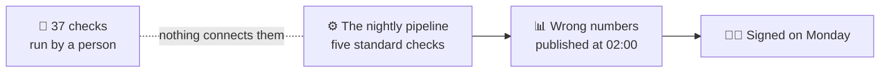

# BRD: Milestone 4, Gates and quarantine

**Status:** Final; built
**Milestone:** 4 of 5 (see the project [README](../../../README.md#milestones))

> **What this document is.** A business requirements document (BRD) says what the business needs and why. It uses business words and no technology. Read it first. Next, read the [HLD](HLD.md) to see what is built.

## 1. The business problem

Lotus Retails is a fictional chain of supermarkets: six stores in three towns. Customers pay at the tills. A till is the machine at the counter where a customer pays. It is also called a cash register.

After three milestones Lotus has 37 checks, each with a reason. A person can run them and get a list of every bad row.

And every night at 02:00 the pipeline still runs its five standard checks, turns green, and publishes:

- six wrong store totals, from which the bonus is paid
- an order list that costs $209,558.00 where $1,550.02 is right
- a member list with one person twice

The checks know. The pipeline does not ask them.

## 2. The question to answer

> Can I pay the bonus from last week's net sales, store by store? And if I cannot trust a number, which one, and why?

After this milestone the pipeline answers both sentences, every night, by itself.

## 3. What must happen when a check fails

A failed check must **do** something. There are three choices, and the business chooses for each check.

| Choice | What happens | When it is the right one |
|---|---|---|
| **Stop** | Nothing new is published. People keep reading yesterday's numbers | Publishing would show wrong numbers for everyone: a store is missing from the stores table |
| **Set aside** | The bad rows are put to one side with the reason. The good rows go on. The report says what is missing | A few rows are bad and the rest are fine: one refund with the wrong sign |
| **Warn** | Everything is published. The warning is written down | The number is still right: a store charged yesterday's price. Someone should know. Nothing should stop |

Stopping is safe and expensive: six stores wait because of one row. Warning is cheap and easy to ignore. Most faults belong in the middle.

## 4. The decisions

Made with the people who are hurt.

| Fault | Decision | Decided with |
|---|---|---|
| A broken stores table or price list | **Stop.** Every number would be wrong | Head of retail operations |
| The receipts and the tills differ, and nobody can say why | **Stop.** A fault no check knows is the most dangerous kind | Finance |
| A refund with the wrong sign, a weight that cannot be true, a sale outside opening hours | **Set aside** the rows. Do not pay that store yet | Head of retail operations |
| A sale stored twice | **Set aside** the extra copies. The day is right again, so pay | Finance |
| A store that sent no file | **Publish the others.** Do not pay that store yet | Head of retail operations |
| A supplier's file that breaks the contract | **Refuse the whole file.** Keep using the last good costs | Finance |
| A stock count that is missing | **Warn**, and do not guess: the order list says "no count: order by hand" | The replenishment team |
| The same person twice | **Set aside** the newer member, so she gets one email | Marketing |
| Yesterday's price charged today | **Warn.** The sales number is right | Finance |
| A day far from normal | **Warn.** It is a reason to look, not a proof | Head of retail operations |

## 5. Rules for setting rows aside

| Rule | Why |
|---|---|
| Every row that is set aside carries its reason | Someone must be able to fix it |
| Nothing is repaired by guessing. A refund with the wrong sign is not flipped | A guess that is wrong is a new fault, with no trace |
| The published numbers say what they are missing | A number with rows missing looks exactly like a complete one |
| A store with a day that does not add up is not paid for that week, until someone looks | The bonus is money |
| If more than 5% of one file is bad, the whole file is refused | When a twentieth of a file is wrong, the rest cannot be trusted either |
| A member who is set aside is named by number only | Personal data must not be copied into more tables |

## 6. What this milestone must deliver

1. Every check moved to one place, with what a failure does written beside it.
2. Three places in the nightly run where checks stand: when the files land, after cleaning, and before the outputs are published.
3. Bad rows set aside with their reason, and good rows carried on.
4. A bonus report that says, for each store: pay, or do not pay yet, and why.
5. Proof for each planted fault: its check catches it, in the nightly run, and the right thing happens.
6. Proof that a stop really stops: nothing new is published, and the old numbers stay.

## 7. Scope

**Out of scope for this milestone:**

| Not yet | Arrives in |
|---|---|
| Telling a person that a check failed | Milestone 5 |
| Whether a file was late, and how late | Milestone 5 |
| Fixing the source and running one night again | Milestone 5 |

Never in this project: a dedicated quality tool such as Great Expectations or Soda. One check is shown as it would look in each, in a short table. The tool changes. The reasoning does not.

## 8. Success criteria

- On Monday morning the report says: one store can be paid, five cannot. Each of the five has one plain line that names the day, the rows and the reason.
- The store that can be paid, `S01`, has exactly the number its receipts add up to: $5,153.25.
- Two supplier files are refused, and every order on the list has its true cost.
- A missing stock count gives "order by hand", not an order of 18.
- With a store deleted from the stores table, nothing new is published, and the old numbers are still there.
- With four clean weeks, every check passes, nothing is set aside, and all six stores can be paid.

## 9. Assumptions

- The tills' own totals are right. They decide whether a store's day adds up.
- "Do not pay yet" is a decision for a person. This milestone gives her the row. It does not make the phone call.
