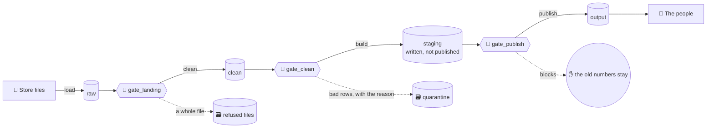
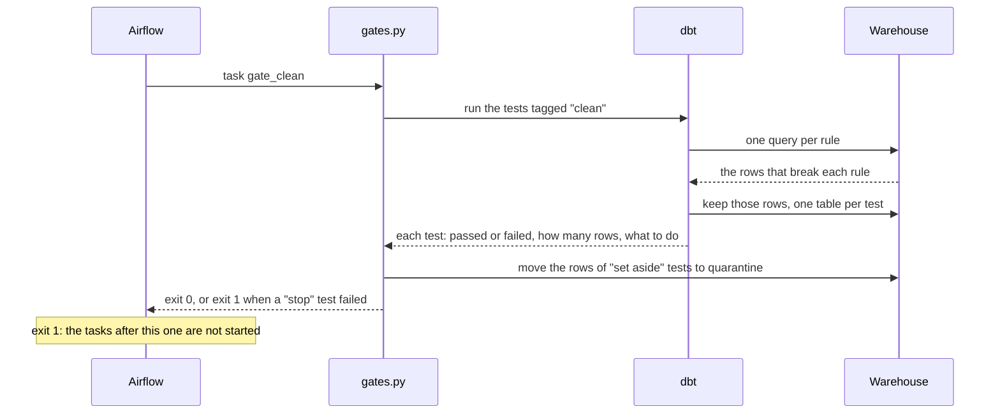
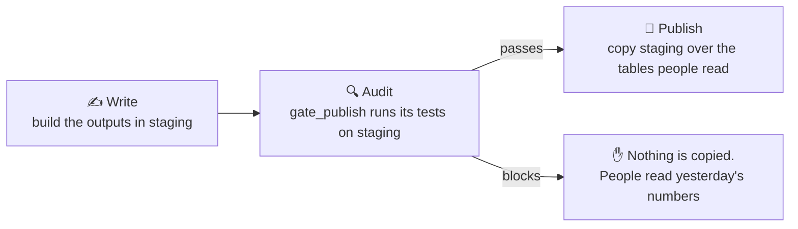
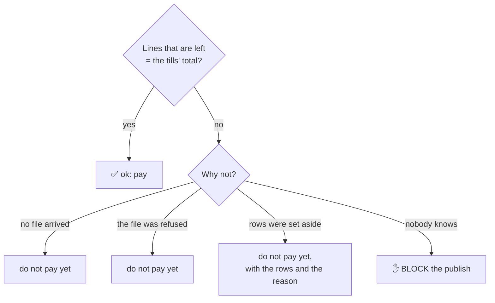

# HLD: Milestone 4, Gates and quarantine

**Status:** Final; built
**Satisfies:** [BRD](BRD.md)

> **What this document is.** A high-level design (HLD) names the parts of the system, what each part does, and how data moves between them. It gives no exact columns or functions. Read it after the [BRD](BRD.md). The [LLD](LLD.md) then gives the exact detail.

## 1. The pipeline, with its gates

The checks move into the nightly run. They stand in three places. Each place is a **gate**: a step that runs checks and decides whether the data may go on.

| Part | State |
|---|---|
| Three gates | **New** |
| A dbt project that holds every rule | **New.** The Python check lists of milestones 2 and 3 are gone |
| Quarantine tables, and a table of refused files | **New** |
| A staging area for the outputs | **New** |
| The bonus report says "pay" or "do not pay yet" | **Changed** |
| Alerts, run history, recovery | ❌ Not yet |

## 2. Who does what

Two tools, two jobs. Beginners mix them up, so this project keeps them apart.

| | dbt | Airflow |
|---|---|---|
| Its job | **It holds the rule** | **It runs the rule and acts on the result** |
| What it knows | "The receipts must equal the till total" | When the check runs, what waits for it, what happens when it fails |
| It is | A query in a file, that returns the rows that break the rule | A task in a DAG, with arrows to the tasks after it |
| It does not know | What should happen next | What a refund is |

Between them stands one small piece of this project's own code, `gates.py`. It starts dbt, reads what each test found, and does what the test's own settings say: stop, set aside, refuse or warn.

## 3. Where a gate stands

The same check protects different things in different places.

| Gate | It stands | It can see | It can do | Its checks |
|---|---|---|---|---|
| `gate_landing` | When the files have landed | Each file's own columns, and its values against the contract | Refuse a whole file | A missing column, a new column, the supplier's contract |
| `gate_clean` | After cleaning | Typed values, joined to other tables | Set rows aside. Stop on a broken reference table | 39 tests: the checks of milestones 1 to 3 |
| `gate_publish` | Before the outputs are shown | Tonight's outputs, as they will be read | Stop the publish | Does each store's day add up to its tills, or can we say why not |

The earlier a fault is stopped, the less it has touched. But some faults do not exist yet at the door: the join that drops a sale with no product happens in the cleaning step.

## 4. Write, audit, publish

The outputs are not built in the place where people read them.

Without this, a check after the fact could only say "we already showed everyone a wrong number".

## 5. Four things a failed test can do

| Action | What `gates.py` does | The task | The readers see |
|---|---|---|---|
| **Block** | Nothing more. It ends with exit code 1 | Fails. Airflow marks every task after it `upstream_failed` and does not start them | Their last good numbers |
| **Quarantine** | Moves the rows the test returned into a quarantine table, each with the reason | Succeeds | The good rows. And a status that says what is missing |
| **Refuse the file** | Lists the file as refused. The cleaning step leaves its rows out | Succeeds | The last good file's values |
| **Warn** | Writes the warning down | Succeeds | Everything |

## 6. A partial load that says so

Setting rows aside has a danger: a number with rows missing looks like any other number.

So the pipeline publishes one more table, `store_day_status`. For every open store and day it holds the answer to one question: do the sales lines that are left add up to the tills' own total?

A sale stored twice is the kind case: the extra copies are set aside, the day adds up again, and the store is paid. A refund with the wrong sign is not: without that row the day is $9.49 too high, so the store waits.

The last branch is the important one. A difference that no check explains means a fault nobody thought of. That is not set aside. That stops the publish.

## 7. Key design decisions

| Decision | Reason |
|---|---|
| Every check is a dbt test, and the Python lists are deleted | One place for the rules. Two copies of a rule drift apart |
| A test says in its own file what a failure does | The decision sits beside the rule, where a reviewer sees both |
| dbt's `error` is used only for "block" | dbt then fails only where the pipeline must stop. Everything else is `warn`, and this project's code acts on it |
| dbt keeps the rows every test returns | A person can look at them. And the pipeline can move exactly those rows |
| The clean tables and the quarantine are rebuilt every night | A row that was bad yesterday is judged again today. When the source is fixed, the row comes back by itself |
| Nothing is repaired by guessing | A flipped sign is a new, invisible change. A row set aside is a visible one |
| Extra copies are set aside, and the first copy stays | A copy is the one fault that can be repaired safely: the truth is still in the table |
| More than 5% of a file set aside refuses the whole file | When that much is wrong, the rest of the file is not to be trusted. Copies do not count |
| A missing stock count is not read as zero any more | The pipeline's own rule was the fault. It is fixed, and a test watches it |
| Unit tests for the two prepared models | The status of a store's day decides pay. Its SQL must be proved on rows where the answer is known |
| Gates are not tried again | A test that failed on the data will fail again. A person must look |

### Stop, set aside, or warn: the same fault, three ways

| For the refund with the wrong sign | The night | The bonus report |
|---|---|---|
| **Stop** | Nothing is published | Six stores wait, for one row |
| **Set aside** (chosen) | Published, without that row | Five stores are paid. `S03` waits, with the reason |
| **Warn** | Published, with that row | Six stores are paid. One of them $18.98 too high |

## 8. What this design costs

| Cost | What happens | Fixed in |
|---|---|---|
| Nobody is told | A gate fails or sets rows aside at 02:00. The report is right, and nobody reads it until Monday | Milestone 5 |
| A late file and a missing file look the same | Both are "no sales file arrived" | Milestone 5 |
| Nothing comes back by itself | A row stays set aside until the source is fixed and the night is run again | Milestone 5 |
| A night takes longer | About 15 seconds more for the three gates | Accepted |

## 9. Technology

dbt is new: dbt-core 1.12, with the Postgres adapter under Docker and the DuckDB adapter for the two-minute run and the tests. `uv sync` installs both into the project's `.venv`. The Airflow image is rebuilt once, because dbt is added to it.

**Not installed, and shown:** Great Expectations and Soda, as one check written three ways. Airflow's own SQL check operator, as one small lab DAG.

## 10. Risks

| Risk | Handling |
|---|---|
| A gate stops the pipeline on good data | Four clean weeks pass every gate, in a test |
| Good rows are set aside | A test compares what is set aside with the planted faults, row by row |
| A blocked night still changes what people read | A test compares the published table before and after a blocked run |
| dbt behaves differently on the two databases | The whole week is tested on DuckDB and on Postgres |
