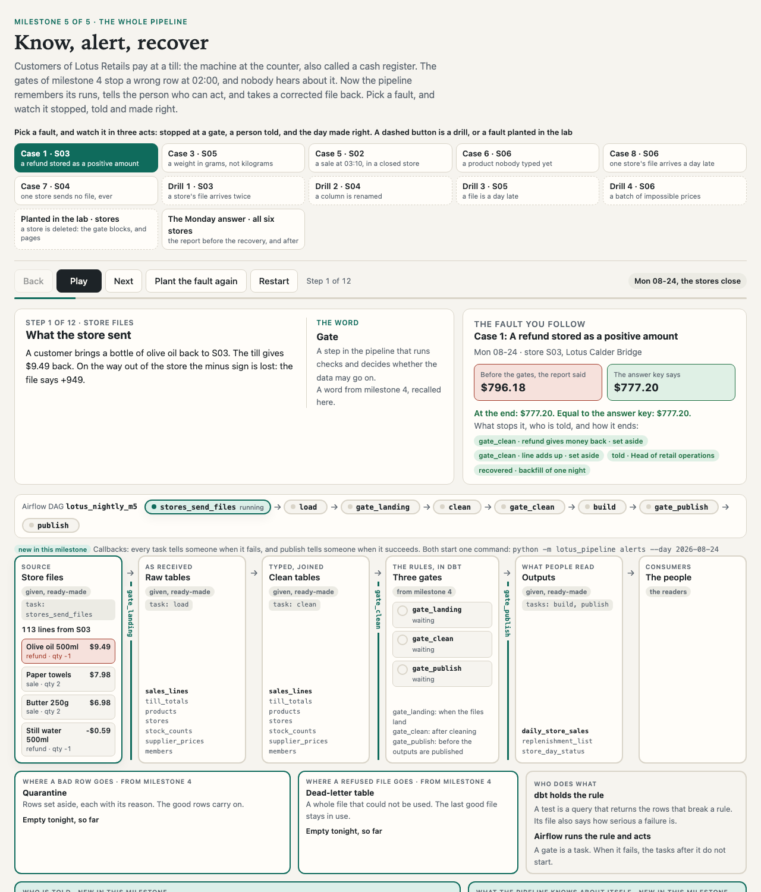

# Milestone 5: Know, alert, recover

**Status:** Done. Design documents, lab notebooks, production code, tests, flow page and recap page are complete. This is the last milestone.

This folder is self-contained. Nothing in it imports from another milestone.



## Why this milestone exists

Since milestone 4 the pipeline stops bad data, and its Monday report is right: 1 of 6 stores can be paid.

That report has said "store `S04` sent no file" since **Tuesday night**. Nobody read it. On Tuesday someone could have called the store. On Monday five managers wait for their bonus, and it is six days too late to ask. **A check that nobody hears about protects nobody.**

Lotus Retails is a chain of supermarkets. Customers pay at the tills. A till is the machine at the counter where a customer pays. It is also called a cash register.

**What you build:** three things around the gates.

- **Know.** The pipeline remembers every run, and measures itself with four numbers. "On time" becomes a number with a target.
- **Alert.** Airflow tells the person who can act, on the night: what failed, how bad it is, what to do. Then you send too many alerts, feel the cost, and fix it.
- **Recover.** Four drills. Fix the source, run only that day again with an Airflow backfill, and prove the number equals the answer key.

**The outcome:** the answer to the Monday question.

```
  Store                           Manager              Net sales  Bonus (1%)   Pay?
  S01  Lotus Ashby High Street    Marta Lindqvist      $5,153.25      $51.53   yes
  S02  Lotus Ashby Market Square  Dana Okafor          $5,748.63      $57.49   yes
  S03  Lotus Calder Bridge        Tomas Reyes          $5,087.62      $50.88   yes
  S04  Lotus Calder Station       Ines Marchetti       $4,585.57           -   DO NOT PAY YET
         Tue 08-25: no sales file arrived. The tills counted $587.42
  S05  Lotus Fenwick Green        Samir Haddad         $3,593.05      $35.93   yes
  S06  Lotus Fenwick Harbour      Aiko Tanaka          $4,418.89      $44.19   yes

  5 of 6 stores can be paid.
```

Yes for five stores, each with exactly the number its receipts add up to. No for one, and here is the row that says why.

## The numbers

| Notebooks | Tests | dbt tests | Alerts sent in the bonus week | If every failed test rang | Sales files on time | Recovery drills | Stores paid, before and after recovery | New words |
|---|---|---|---|---|---|---|---|---|
| 8 | 140 | 48, and 2 unit tests | 10, each once | 70 | 39 of 41: 95.1%, against a target of 98% | 4 | 1 of 6, then 5 of 6 | 16 |

## Who does what

| | dbt | Airflow | The pipeline's own code |
|---|---|---|---|
| Its job | It holds the rule | It runs the rule, and it knows **when** to tell someone: a task failed, or the night is published | It knows **whom** to tell and **what** to say |

## Read it in this order

1. **[The flow page](https://vijaysngrajput.github.io/quality-gates-on-a-running-pipeline/src/m5_know_alert_recover/milestone_5_flow.html)**: open it first. Pick a fault, and follow it to the person who is told and back to a right number.
2. [docs/BRD.md](docs/BRD.md): who must be told, and what "on time" means as a number.
3. [docs/HLD.md](docs/HLD.md): know, alert, recover, and why recovery is boring.
4. [docs/LLD.md](docs/LLD.md): the tables, the alert rules, the callbacks, the backfill. Keep it open for the next two steps.
5. The notebooks in `notebooks/`, from `01` to `08`.
6. The code in `lotus_pipeline/`, the DAG in `dags/`, [RUNBOOK.md](RUNBOOK.md), and `tests/`.
7. The seven check cards in [checks/](checks/). Every card is complete: question 7 now says who is told.
8. The flow page again.
9. **[The recap page](https://vijaysngrajput.github.io/quality-gates-on-a-running-pipeline/src/m5_know_alert_recover/milestone_5_recap.html)**: a look back at the milestone, and at the whole project.

In your own copy of the project, the two pages are `milestone_5_flow.html` and `milestone_5_recap.html` in this folder. Open them in a browser.

## What is in this folder

| Folder or file | Holds |
|---|---|
| [docs/](docs/) | [BRD](docs/BRD.md), [HLD](docs/HLD.md) and [LLD](docs/LLD.md), each with diagrams |
| `notebooks/` | The lab: eight notebooks, run in order, plus `lab_helpers.py` |
| `lotus_pipeline/` | New: `history.py`, `health.py`, `alerts.py`. Changed: `load.py`, `pipeline.py` |
| [RUNBOOK.md](RUNBOOK.md) | **New.** What each alert means, and the first things to check |
| [incidents/](incidents/) | **New.** A template for an incident note, and the note written in the lab |
| `dbt_project/` | The rules, with two more tests: freshness, and impossible prices |
| `dags/` | `lotus_nightly_m5`: the eight tasks, now with callbacks |
| `airflow_tools.py` | Drive Airflow from Python: run a night, backfill, switch a fault on inside the container |
| `checks/`, `contracts/` | The seven check cards, and the suppliers' contract |
| `tests/` | Tests for all of it |
| `milestone_5_flow.html`, `milestone_5_recap.html` | The two animated pages |

The live page of the finished pipeline, with the alerts page, is in [pipeline_live/](../../pipeline_live/).

## Set up

**Nothing new to install.** Airflow's callbacks and its backfill command are part of Airflow. The commands are the same on macOS, Linux and Windows. From the project folder:

```sh
docker compose up -d
```

**Prove it:** `docker compose ps` lists both containers as `Up`. Open http://localhost:8080 : there is one more DAG, `lotus_nightly_m5`.

If you skipped the earlier milestones, do [milestone 1's set-up](../m1_green_checks_wrong_number/#set-up) first, and then `docker compose up -d --build` once, as in milestone 4.

## Shut it down

Nothing in this project stops by itself. From the project folder:

```sh
docker compose down
```

It stops both containers and keeps your data. How to delete the data and free the disk space is in [milestone 1's README](../m1_green_checks_wrong_number/#shut-it-down).

## The lab

Open the notebooks in VS Code, choose the project's `.venv` as the kernel, and run them in order. Each takes about ten minutes to read. Most of them drive the real Airflow, so they need both containers, and some take a few minutes to run.

| Notebook | What you do | New words |
|---|---|---|
| `01_did_it_run` | Read the pipeline's own memory of its runs, and Airflow's | Run history |
| `02_on_time_as_a_number` | Say "on time" as a number with a target. Find the promise that was missed | Freshness; SLI, SLO and SLA |
| `03_five_signals` | Five things to watch, and where each one already lives in this project | Volume, observability |
| `04_tell_the_person_who_can_act` | Let Airflow tell someone: what, how bad, what to do | Alert, callback, routing, runbook |
| `05_too_many_alerts` | Send 70 alerts in a week. Then 10 | Alert fatigue |
| `06_fix_one_day` | Fix one fault at its source, run one night again, and prove the number | Incident, root cause, reprocessing, backfill, safe re-run |
| `07_four_drills` | A file twice, a renamed column, a late file, impossible prices. Write the note | Incident note |
| `08_the_monday_answer` | The whole week, the recovery, and the answer | |

## Run it from a terminal

From this folder. One night, as a plain program:

```sh
uv run python -m store_systems deliver --through 2026-08-24
uv run python -m lotus_pipeline run --day 2026-08-24          # nine steps: the last two are alerts and report
```

Its last lines before the report:

```
alerts:       1 sent (0 page, 1 ticket). 0 still open, not sent again. 0 resolved. 0 in the digest.
    TICKET  to Head of retail operations: S03 Mon 08-24: Rows were set aside, and the day does not add up. 1 row, $9.49: A line adds up; A refund gives money back. The receipts and the tills are $9.49 apart. Tomas Reyes's bonus waits. Do: Look at the rows in quarantine.sales_lines. Ask the store for a corrected file. Do not pay yet. (RUNBOOK.md#rows-were-set-aside)
```

Is the pipeline healthy?

```sh
uv run python -m lotus_pipeline health --day 2026-08-24
```

Recover: the store sends a corrected file, and that one night is run again.

```sh
uv run python -m store_systems fix --case 1
uv run python -m store_systems deliver --day 2026-08-24
uv run python -m lotus_pipeline run --day 2026-08-24
```

```
load:         1 new files, 113 rows copied to the raw tables. 1 changed file loaded again.
...
alerts:       0 sent (0 page, 0 ticket). 0 still open, not sent again. 1 resolved. 0 in the digest.
    RESOLVED to Head of retail operations: S03 Mon 08-24: Rows were set aside, and the day does not add up
```

Under Airflow the same recovery is a fix inside the container, and a backfill:

```sh
docker compose exec -w /opt/lotus airflow /opt/lotus-venv/bin/python -m store_systems fix --case 1
docker compose exec airflow airflow backfill create --dag-id lotus_nightly_m5 \
    --from-date 2026-08-24 --to-date 2026-08-25 --reprocess-behavior completed --max-active-runs 1
docker compose exec airflow tail /var/lotus/alerts.log
```

On Windows PowerShell, write the backfill on one line, without the `\`.

The plain commands use the warehouse in Docker. To use a database in one file, with nothing running, set `LOTUS_WAREHOUSE=duckdb` first.

## Run the tests

```sh
uv run pytest
```

About three minutes: the tests run dbt for every night of the week on two databases, and then the four drills. Nothing needs to be running. When the warehouse is up, the week is tested a second time on Postgres.

The tests prove the three halves of the title. **Know:** the four health numbers. **Alert:** ten tickets in the week, never one twice, each to the person who can act, and no check that nobody hears about. **Recover:** each drill ends with the published number equal to the answer key.

## The pages show real numbers

No number on the flow page or the recap page is typed by hand. A script runs the real pipeline, with its gates, its alerts and its recoveries, and writes what happened into the pages. A test fails when a page is out of date.

```sh
uv run python -m lotus_pipeline.flow_data
```

## Five things you learn

1. A check that nobody hears about protects nobody.
2. Say "on time" as a number, with a target, and measure it.
3. An alert goes to the person who can act, once, with what to do.
4. Never repair in the warehouse. Fix the source, and run the day again.
5. A safe re-run makes recovery boring. Boring is the goal.

## New words

| Word | Meaning |
|---|---|
| **Run history** | What the pipeline remembers about its own runs: which night, which step, how it ended, how long it took |
| **Freshness** | How new the data is. A freshness check asks: did the newest data arrive in time? |
| **Volume** | How much data arrived. A volume check asks: is the row count near the usual count? |
| **SLI, SLO and SLA** | An SLI is a number you measure, such as the share of files that arrived by 01:00. An SLO is the target for it. An SLA is a promise to other people, with a cost when it is broken |
| **Observability** | Being able to tell from outside whether the data is right, not only whether the job ran. It watches five signals: freshness, volume, schema, distribution and lineage. Also called the five pillars |
| **Alert** | A message to a person that something needs them: what failed, how bad it is, what to do |
| **Callback** | A function Airflow calls by itself when a task changes state, such as when it fails |
| **Routing** | Sending each alert to the person who can act on it |
| **Alert fatigue** | People get so many alerts that they stop reading them |
| **Runbook** | A short note that says what an alert means and the first things to check |
| **Incident** | A time when the data was wrong or late for the people who use it |
| **Root cause** | The first thing that went wrong, the one that made the others happen |
| **Reprocessing** | Loading and building the same data again, after the source was corrected |
| **Backfill** | Running the pipeline again for past days, with one command |
| **Safe re-run** | A run that can be repeated and gives the same result: nothing is counted twice |
| **Incident note** | A short written record of an incident: what happened, who was hurt, why, and what was changed. Also called a post-mortem |

Each word has an interview line in the project's [GLOSSARY.md](../../GLOSSARY.md).

**Shown, not installed:** a paging service such as PagerDuty, and Slack alerts. Airflow sends each alert from a real task callback to a local alerts page and a log file, so no account is needed. A real team plugs its tool in at the one place where the line is written.

## Test yourself

**1. It is Wed 08-26, 02:00. S04 sent no sales file for Tuesday. The pipeline publishes the other five stores and marks S04 "do not pay yet". Milestone 4 did that too. What is different tonight?**

Someone is told. When publish succeeds, Airflow calls a callback, and one ticket goes to the head of retail operations: "S04 Tue 08-25: No sales file arrived". It says how much is in doubt and what to do: ask the store's back office for the file. On Tuesday night the store can still send it. On Monday morning it is too late.

**2. The same ticket about S04 is still true on Wednesday, Thursday and Friday night. A teammate wants it sent again every night, so nobody forgets. Good idea?**

No. That is how 70 alerts come from one week in place of 10: every failed test, every night. People then stop reading them, and miss the one that is new. That is alert fatigue. Send a problem once, when it is new. Count it as still open after that, and say so when it is resolved.

**3. The store sends the right file for Monday. A colleague offers to save time: change the one wrong row in the warehouse by hand. What do you say?**

Never repair in the warehouse. The clean tables are built again from the raw rows every night, so the hand-made fix is gone tomorrow, and nobody can see it was made. Let the store send the corrected file, and run that one night again. The load step sees that the file changed and loads it again, and a file that did not change is skipped. That is a safe re-run.

## Still wrong

Nothing.

The pipeline is given. The checks have reasons. The gates stop what must be stopped, set aside what can be set aside, and warn about the rest. The right person is told on the night. And a wrong day can be made right with one command.

What is left belongs to other projects of the series, and to real tools.

| Not built here | Where it belongs |
|---|---|
| Building the pipeline itself, and the full story of Airflow | [Daily Orders: API to Warehouse](https://github.com/vijaysngrajput/daily-orders-api-to-warehouse) |
| Checks on events as they arrive | The clickstream project |
| A lake, and table formats | The lakehouse project |
| A dashboard for the health numbers | The warehouse project |
| AI | [Retail Profit Stack](https://github.com/vijaysngrajput/retail-profit-stack) |
| A paging service, a quality tool, a schema registry, lineage tools | Real accounts and real tools. The decisions you made here stay the same |
| Machine-learned anomaly detection | When a weekly average is not enough: holidays that move, slow drift, hundreds of stores |
