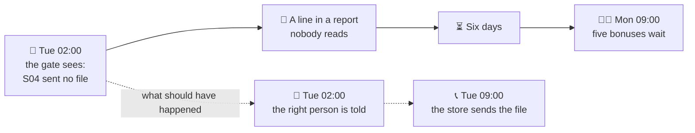

# BRD: Milestone 5, Know, alert, recover

**Status:** Final; built
**Milestone:** 5 of 5 (see the project [README](../../../README.md#milestones))

> **What this document is.** A business requirements document (BRD) says what the business needs and why. It uses business words and no technology. Read it first. Next, read the [HLD](HLD.md) to see what is built.

## 1. The business problem

Lotus Retails is a fictional chain of supermarkets: six stores in three towns. Customers pay at the tills. A till is the machine at the counter where a customer pays. It is also called a cash register.

Since milestone 4 the nightly pipeline stops bad data. On Monday morning its report is right:

> 1 of 6 stores can be paid.

And that is the problem. The report has said "store `S04` sent no file" since **Tuesday night**. Nobody read it. On Tuesday someone could have called the store, and the file would have come. On Monday five managers wait for their bonus, and it is six days too late to ask.

A check that nobody hears about protects nobody.

## 2. The question to answer

> Can I pay the bonus from last week's net sales, store by store? And if I cannot trust a number, which one, and why?

Milestone 4 answers it on Monday. This milestone makes the answer arrive **on the night**, reach the person who can act, and get **better** by Monday.

## 3. Three needs

| Need | The question behind it | Who asks |
|---|---|---|
| **Know** | Is the pipeline healthy? Did it run, did it finish on time, is the data fresh, did every store report? | Head of retail operations, and the data team |
| **Alert** | Who must be told, how urgently, and what should they do? | Everyone who is hurt by a fault |
| **Recover** | The store sent a corrected file. How does the right number get back into the report? | Store managers, whose bonus waits |

## 4. "On time", as a number

"The files are usually on time" cannot be checked. A number can.

| Promise | The number |
|---|---|
| A store's sales file arrives | By **01:00** the night after the business day |
| The pipeline starts | At **02:00** |
| A night is finished | Within **5 minutes** of its start |
| Files that arrive on time | At least **98%** of them, in any week |

In the bonus week 39 of 41 files were on time. That is 95.1%. The promise was missed, and now Lotus can say by how much, and name the two files.

## 5. Who is told

An alert to everyone is an alert to no one. Each kind of fault has one person who can act.

| What happened | Who can act | How urgent |
|---|---|---|
| A gate blocked. Nothing new was published | The data engineer on call | **Page**: now. Every reader sees old numbers |
| A store's day cannot be paid from | Head of retail operations | **Ticket**: today. A bonus waits |
| A supplier's file was refused | Finance, and the buying team | **Ticket**: today. Old costs are in use |
| A store charged yesterday's price | Finance | **Ticket**: today. Money is lost at the till |
| A stock count is missing | The replenishment team | **Ticket**: today. An order must be made by hand |
| The same person signed up twice | Marketing | **Message**: when you can |
| A file was late, and has arrived | Store operations | **Message**: when you can |

## 6. What an alert must say

| It must say | Example |
|---|---|
| **What**, in the words of the business | `S04` Tue 08-25: no sales file arrived |
| **How bad** | The receipts and the tills are $587.42 apart. Ines Marchetti's bonus waits |
| **What to do** | Ask the store's back office to send the file. Do not pay this store's bonus yet |
| **Where to read more** | A section of the runbook |

It must **not** say: "test `store_is_not_ready_to_pay` failed with 1 row".

## 7. Rules for alerts

| Rule | Why |
|---|---|
| One problem, one alert | The same refund must not ring seven nights in a row |
| A problem that is still there is not sent again | People stop reading what repeats |
| When a problem is gone, its alert is closed, and the person is told | Otherwise nobody trusts an open alert |
| Only a page may wake someone | If everything is urgent, nothing is |
| A message waits in a digest | It needs no person today |
| No alert carries a member's name, email or phone | An alert travels further than any table |

## 8. Rules for recovery

| Rule | Why |
|---|---|
| A fault is fixed at its source, never in the warehouse | A row repaired by hand comes back wrong the next night |
| Only the day that was wrong is run again | Running everything again is slow, and hides what changed |
| Running a night twice changes nothing | Recovery must not be able to make things worse |
| The repaired number is proved | It is held against the tills' own total, and in this project against the answer key |
| Every incident gets a short written note | What happened, who was hurt, why, what was changed |

## 9. What this milestone must deliver

1. The pipeline's own run history, and four health numbers with a target each.
2. Alerts sent by Airflow on the night, to the right person, each saying what, how bad and what to do.
3. Proof that the careless way, an alert for every failed check, is seven times as loud.
4. Four recovery drills: a file arrives twice, a column is renamed, a file is a day late, a batch of impossible prices.
5. For each drill: which gate caught it, what was set aside, what the manager saw, who was told, the fix, and the proof.
6. The final answer to the Monday question.

## 10. Scope

This is the last milestone. Out of scope for the whole project:

| Not here | Why |
|---|---|
| A paging service such as PagerDuty, or Slack alerts | They need an account. Alerts go to a local page and a log file. The callback that sends them is real |
| Data lineage tools, a schema registry, a dedicated quality tool | Named and shown. Not installed |
| Machine-learned anomaly detection | A normal-day comparison is used, and the project says where that stops being enough |

## 11. Success criteria

- In the bonus week, ten tickets are sent, each once, each to the person who can act.
- `S06`'s late file: a ticket on Thursday night, closed on Friday night, with no person doing anything.
- After four stores send corrected files and their four nights are run again: **five stores can be paid, each with exactly the number its receipts add up to. One cannot.**
- The one that cannot is `S04`: "Tue 08-25: no sales file arrived. The tills counted $587.42". One ticket is still open, and it says the same.

## 12. Assumptions

- A store can send a corrected file under the same name. It cannot take a file back.
- `S04`'s Tuesday file never arrives before the sign-off. That is realistic, and it is why the answer is not six of six.
