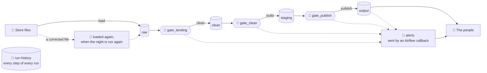
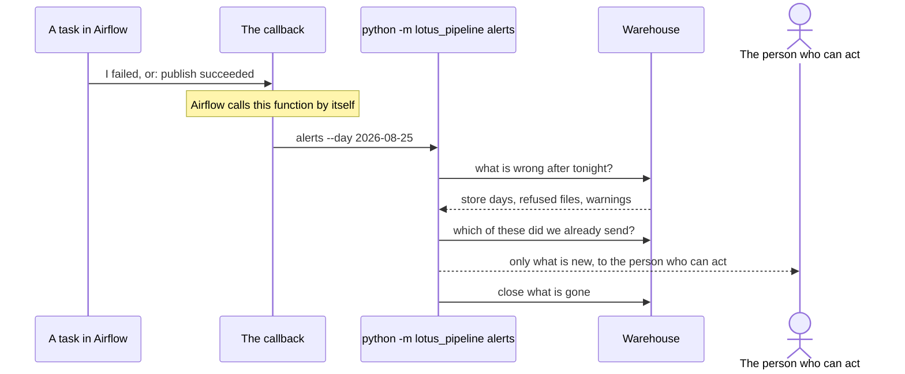
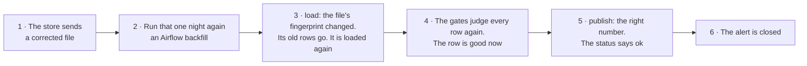

# HLD: Milestone 5, Know, alert, recover

**Status:** Final; built
**Satisfies:** [BRD](BRD.md)

> **What this document is.** A high-level design (HLD) names the parts of the system, what each part does, and how data moves between them. It gives no exact columns or functions. Read it after the [BRD](BRD.md). The [LLD](LLD.md) then gives the exact detail.

## 1. The finished pipeline

The gates of milestone 4 stay where they are. Three things are added around them.

| Part | State |
|---|---|
| The eight tasks and three gates | As in milestone 4 |
| **Know:** run history, and four health numbers | **New** |
| **Alert:** alerts from Airflow callbacks, with levels, routing and a runbook | **New** |
| **Recover:** a corrected file is loaded again. One night is run again with a backfill | **New** |
| A freshness test, and a test for impossible prices | **New** |

## 2. Know

Two questions that sound alike and are not.

| | Monitoring | Observability |
|---|---|---|
| It asks | Did the job run and finish? | Is the data right? |
| Lotus before this project | Yes: green every night | Nobody asked |

Observability watches five signals. Each one already has a home in this project.

| Signal | It asks | Built in |
|---|---|---|
| **Freshness** | Did the data arrive in time? | This milestone: a file is due by 01:00 |
| **Volume** | Is the amount of data normal? | Milestone 2: a store's day against its normal day |
| **Schema** | Did the columns change? | Milestone 3: the first line of every file is kept |
| **Distribution** | Do the values look normal? | Milestones 1 and 2: profiling, and a believable weight |
| **Lineage** | What does this table feed? | Milestone 1: the map of what reads what |

The pipeline also keeps its own **run history**: one row for every step of every run. Airflow has a run history too. The pipeline's own is there even when a person runs a step by hand.

From the history and the tables come four health numbers. Each is an **SLI**, a number you measure. Each has an **SLO**, a target.

| Question | SLI | SLO |
|---|---|---|
| Did it run? | Nights that published | Every night |
| Did it finish on time? | Seconds a night took | Under 300 |
| Is the data fresh? | Share of sales files that arrived by 01:00 | 98% |
| Did every store report? | Share of store days that can be paid from | Shown. A person judges |

An **SLA** is different: a promise to other people, with a cost when it is broken. Lotus has none in writing. If the head of retail operations promised the managers "your bonus is confirmed by Monday 09:00, or you are told why", that would be one.

## 3. Alert

**Who does what.** Airflow knows **when** to tell: a task failed, or the night is published. The pipeline knows **whom** and **what**: it reads tonight's results and decides. dbt still holds the rules.

Only the destination is local. The alert is written to a table, to one line in a log file, and to the task's log. A real team would plug in email, Slack, or a paging service such as PagerDuty, at the one place where the line is written.

### From a failed test to an alert a person can act on

| Step | What it does | Why |
|---|---|---|
| **Group** | One alert per problem: a store's day, a file, a product. Not one per failed test | The refund fails two tests. It is one problem |
| **Send once** | A problem gets a fingerprint. One that was already sent is counted as "still open", and not sent | The same refund fails every night until it is fixed |
| **Rank** | Page, ticket, message | Only a page may wake someone |
| **Route** | Each kind of problem has one person | The person who can act is not always the data team |
| **Silence** | A message is not sent. It waits in a digest | It needs nobody today |
| **Close** | A problem that is gone is marked resolved, and the person is told | An open alert must mean something |

The same week, both ways:

| | Shout: every failed test, every night, to everyone | Grouped, sent once, routed |
|---|---|---|
| Alerts in the bonus week | 70 | 10 |
| The refund at `S03` | 14 alerts: two tests, seven nights | 1 ticket |
| What people do | Stop reading. This is **alert fatigue** | Act |

## 4. Recover

Three decisions make this boring, and boring is the goal.

| Decision | What it gives |
|---|---|
| The load step keeps a fingerprint of every file it loaded | A file that changed is loaded again. A file that did not is skipped. So a night can be run any number of times |
| The clean tables and the quarantine are rebuilt from raw every night | Nothing has to be "un-quarantined". When the raw row is right, it simply is not set aside |
| Alerts are compared with what is open | When the problem is gone, its alert closes by itself |

Nothing is ever repaired in the warehouse. A row changed by hand would come back wrong the next night, because the raw file is still wrong.

### The four drills

| Drill | Caught by | What happens | Recovery |
|---|---|---|---|
| A store's file arrives twice | `gate_clean`: one item line is stored once | The copies are set aside. The day adds up. The store is paid | None needed. A store cannot take a file back, so the gate removes the copies every night |
| A column is renamed | `gate_landing`: a file has every column | The file is refused. "Do not pay yet". A ticket | A corrected file, and one night run again |
| A file is a day late | `gate_publish`: a store's day cannot be paid from | "No sales file arrived". A ticket | None needed. It arrives, the next night loads it, the ticket is closed. Freshness names it: 23.7 hours late |
| A batch of impossible prices | `gate_clean`: a price is not impossible | A tenth of the file is bad, so the whole file is refused. A ticket | A corrected file, and one night run again |

## 5. Key design decisions

| Decision | Reason |
|---|---|
| Alerts are sent from Airflow callbacks | A callback fires even when the run stops halfway. A last task would not run after a failure |
| The callback only starts a command | Airflow holds no business logic. Who is told is decided in one place, and can be tested without Airflow |
| An alert is made from a problem, not from a test | People act on "store `S04`, Tuesday". Nobody acts on a test name |
| A problem has a fingerprint | It is how "send once" and "close when gone" both work |
| Freshness is measured against the night's own clock | The data is from August 2026. dbt's own freshness command compares with today, and would call everything late |
| A late file and a missing file are told apart | Freshness sees a file that arrived late. Only "every store reported" sees one that never came |
| A price 100 times the list is set aside. Yesterday's price is only a warning | The first is a broken file. The second is real money the till took |
| Recovery is one night, run again | It is small, it is fast, and the run history shows exactly what was done |
| Every incident gets a note | The next person learns from it without having been there |

## 6. What is still wrong

Nothing. The Monday question has its answer:

> Yes for five stores. No for one. `S04`: Tue 08-25, no sales file arrived, the tills counted $587.42.

What a real team would add belongs to other tools, and other projects of this series.

| Not built here | Where it belongs |
|---|---|
| Building the pipeline itself, and the full story of Airflow | Daily Orders |
| Checks on events as they arrive | The clickstream project |
| A lake, and table formats | The lakehouse project |
| A dashboard for the health numbers | The warehouse project |
| A paging service, a quality tool, a schema registry, lineage tools | Real accounts and real tools. The decisions made here stay the same |
| Machine-learned anomaly detection | When a weekly average is not enough: holidays that move, slow drift, hundreds of stores |

## 7. Technology

Nothing new is installed. Airflow's callbacks and its backfill command are part of Airflow 3.4.

## 8. Risks

| Risk | Handling |
|---|---|
| An alert is sent every night for the same problem | A test runs the week and counts: ten tickets, never one twice |
| A check fails and nobody is told | A test goes through every dbt test: it is routed to a person, or covered by another alert |
| A corrected file is counted twice | The old rows are removed before the file is loaded again. A test checks the file is there once |
| A recovery makes another day wrong | After the recovery every paid store's number is held against the answer key |
