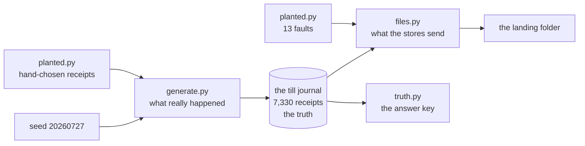

# The store systems

This folder is **the source**: Lotus Retails' tills, back offices, suppliers and loyalty app. It is a small fake, written for this project. It is the outside world. No pipeline code lives here, and every milestone uses the same one.

It is not a server. It is a program that writes the files a pipeline receives.

## Make the stores send files

From the project folder:

```sh
uv run python -m store_systems deliver --day 2026-08-24       # the files of one night
uv run python -m store_systems deliver --through 2026-08-24   # every night up to that day
uv run python -m store_systems status                         # what has arrived
uv run python -m store_systems reset                          # an empty landing folder
```

The files go to the **landing folder**: `data/landing` in the project. To use another folder, set `LOTUS_LANDING`.

Under Airflow the first task of the DAG does this for you, inside Docker.

## What arrives

```
data/landing/
  sales_lines/sales_lines_S03_2026-08-24.csv      one per store, per night
  till_totals/till_totals_S03_2026-08-24.csv      one per store, per night
  stock_counts/stock_counts_S03_2026-08-24.csv    one per store, per night
  products/products_2026-08-24.csv                the whole table, every night
  stores/stores_2026-08-24.csv                    the whole table, every night
  members/members_2026-08-24.csv                  the whole table, every night
  supplier_prices/supplier_prices_SUP-B_2026-08-25.csv   one per supplier, per week
  _arrivals.csv                                   when each file arrived
```

| Table | What one row is | How it is made |
|---|---|---|
| `sales_lines` | One item line on one receipt | Each till writes it. Each store sends a file every night |
| `till_totals` | One till's own total for one day | The till prints it when it is closed |
| `products` | One product at one price | Typed by the buying team |
| `stores` | One store, with its opening hours | Typed once, rarely changed |
| `stock_counts` | One product in one store on one day | Counted by hand or by scanner |
| `supplier_prices` | One product's cost from one supplier | A CSV file the supplier sends |
| `members` | One loyalty member | Typed by the customer in an app |

The columns of each table are in the [data proposal](../docs/source_data_proposal.md#2-the-seven-tables-as-the-stores-send-them).

## The data



- 35 business days: Monday 2026-07-27 to Sunday 2026-08-30. Six stores in three towns, two tills each.
- Weeks 1 to 4 are clean. They are the "normal days" a check compares with.
- Week 5, from 2026-08-24, is the **bonus week**. Every planted case is in it.
- The **till journal** holds every receipt as the till really printed it. It is the truth.
- A file is what arrives. The planted cases are the differences between the two.

## The thirteen planted cases

Every one passes all five standard checks of the starter pipeline. That is the point.

| # | Case | Day | Where |
|---|---|---|---|
| 1 | A refund stored as a positive amount | Mon 08-24 | `S03` |
| 2 | One receipt in the file twice, with different line ids | Tue 08-25 | `S01` |
| 3 | A weight entered in grams, not kilograms | Thu 08-27 | `S05` |
| 4 | A price that was changed yesterday, charged at the old price | Fri 08-28 | `S04` |
| 5 | A sale at 03:10 in a store that closes at 22:00 | Sun 08-30 | `S02` |
| 6 | A sale for a product that is not in `products` | Sat 08-29 | `S06` |
| 7 | One store sends no file | Tue 08-25 | `S04` |
| 8 | One store's file arrives a day late | Thu 08-27 | `S06` |
| 9 | One store's whole file sent twice | Fri 08-28 | `S02` |
| 10 | The supplier renames a column | Tue 08-25 | `SUP-B` |
| 11 | The supplier sends cost in cents | Fri 08-28 | `SUP-C` |
| 12 | A stock count is missing for one day | Fri 08-28 | `S05` |
| 13 | The same member twice, with different letter case in the email | Wed 08-26 | `members` |

Three things look wrong and are not. No check may fire on them.

| What | Day | Why it is right |
|---|---|---|
| A public holiday with low sales | Wed 08-26, all stores | Founders' Day, an invented holiday. The stores open from 10:00 to 16:00 |
| A store closed for one day | Thu 08-27, `S01` | A planned refit. No files, and that is correct |
| A real sale of 400 items | Sat 08-29, `S02` | A café buys 400 bottles of still water |

## Make a store misbehave

Beyond the planted cases, you can switch on a fault of your own. It takes effect the next time that day is delivered.

```sh
uv run python -m store_systems fault file-twice --store S03 --day 2026-08-05
uv run python -m store_systems deliver --day 2026-08-05
```

| Kind | What the store does |
|---|---|
| `late-file` | Sends its sales file a day late |
| `file-twice` | Sends its whole sales file twice, with new line ids |
| `rename-column` | Calls the `amount_cents` column `amount` |
| `bad-prices` | Makes every tenth line 100 times too dear |
| `no-file` | Sends no sales file |

And you can fix things at the source, as a store would after a phone call:

```sh
uv run python -m store_systems fix --case 1        # the store sends the refund right
uv run python -m store_systems fix --all-faults    # switch off every fault you set
```

Milestone 5 uses these for its recovery drills.

## The answer key

`truth.py` works the true numbers out from the till journal. It uses no pipeline code, and it never reads a file a store sent. Two files hold the result, for notebooks, pages and the D8Loop website:

| File | Holds |
|---|---|
| [answer_key/answer_key.json](../answer_key/answer_key.json) | The true net sales of every store on every day, and the bonus week |
| [answer_key/planted_cases.json](../answer_key/planted_cases.json) | The thirteen cases, with dates, amounts, who is hurt and what catches each one |

```sh
uv run python -m store_systems.key_files   # write them again
```

A test fails when they are out of date.

## Files

| File | Holds |
|---|---|
| `catalog.py` | The calendar, the stores, the products and the suppliers |
| `planted.py` | The hand-chosen receipts, and the thirteen cases |
| `generate.py` | Builds the world from the seed: the till journal, the members, the stock and the costs |
| `files.py` | Writes the files. Every planted fault happens here |
| `truth.py` | The answer key |
| `key_files.py` | Writes the answer key and the planted cases as files |
| `business_page.py` | Writes the data of the business page |
| `tests/` | Tests for all of it: `uv run pytest` in this folder |
